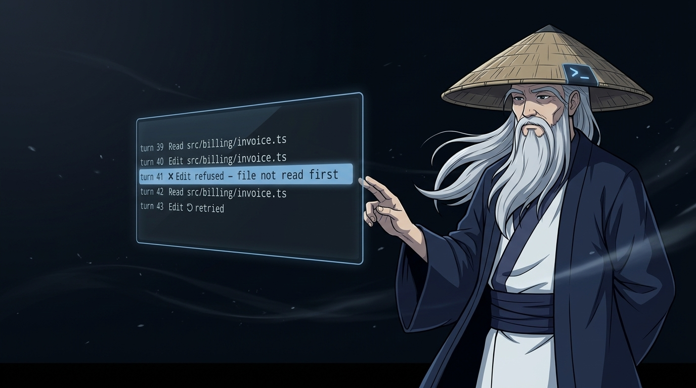

# vibesenpai

<p align="center"></p>

[](https://github.com/vibesenpai/vibesenpai/actions/workflows/ci.yml)
[](LICENSE)
[](package.json)

**Discover how your agents failed you.** vibesenpai reads the sessions already
on your disk and shows you where they went wrong: the exact turns, in your own
words, and a fix you can apply.

It is a Claude Code plugin. It shows evidence, and a fix you can apply. It does
not score you and does not tell you how to work.

**[Documentation](https://vibesenpai.github.io/vibesenpai/)** ·
[What it shows you](https://vibesenpai.github.io/vibesenpai/start/what-it-is/) ·
[What leaves your machine](https://vibesenpai.github.io/vibesenpai/start/sends-and-costs/)

## Install

In Claude Code:

```
/plugin marketplace add vibesenpai/vibesenpai
/plugin install vibesenpai@vibesenpai
```

It needs Node 22.13 or later on your PATH, and Claude Code 2.1.224 or later.

## Getting started

1. **Keep working.** The free checks read every session. Model reads run in the
   background after a turn ends, within about 2M tokens a day, on your own
   Claude Code account (plan or API key). A one-time notice at session start
   says so.
2. **Open the pane.** `/vibesenpai:insights` opens it beside the chat. Each
   finding leads with your own words and the turns where it went wrong.
3. **Apply a fix you agree with.** Apply drafts the change into your prompt box.
   Your Enter is the yes, and the agent makes the change under Claude Code's own
   permission prompt.

| Command | What it does |
|---|---|
| `/vibesenpai:insights` | the pane: findings, their fixes, and Apply |
| `/vibesenpai:judge` | model reads on or off; no argument shows their status |
| `/vibesenpai:report` | a self-contained HTML report of your history |

`/vibesenpai:judge off` stops the model reads and keeps the free checks.
`/plugin disable vibesenpai` turns everything off.

To update to a new release: `/plugin`, then **Installed**, vibesenpai, **Update
now**; or `claude plugin update vibesenpai@vibesenpai` from a terminal.

## What leaves your machine

Your transcripts are read where Claude Code keeps them and are never copied.
With model reads on, a redacted, length-capped copy of session text goes to
Claude Haiku on your own Claude Code account (plan or API key), and the send
stops if redaction left anything behind. Session text includes what the agent's
tools returned, such as files it read and command output, so code from a
session can be part of it. vibesenpai never opens your repository or writes
your files; a fix is made by the agent, after you press Enter. [The full terms](https://vibesenpai.github.io/vibesenpai/start/sends-and-costs/).

## Contributing

See [CONTRIBUTING.md](CONTRIBUTING.md) and
[the contributor guide](https://vibesenpai.github.io/vibesenpai/contribute/).
Briefly:

```bash
git clone https://github.com/vibesenpai/vibesenpai && cd vibesenpai
npm install
npm test                       # the whole suite, no network
npm run cli -- insights        # run against your own sessions
```

There are no runtime dependencies, on purpose. `npm run verify:corpus` fails if
any published count changes or anything leaks; it fetches the public corpus it
needs.

## License

MIT. See [LICENSE](LICENSE).
