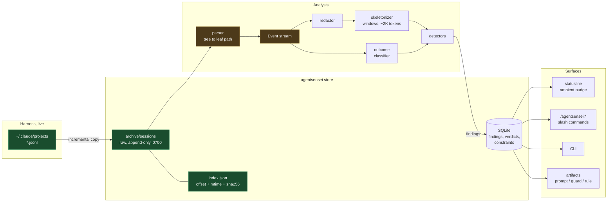
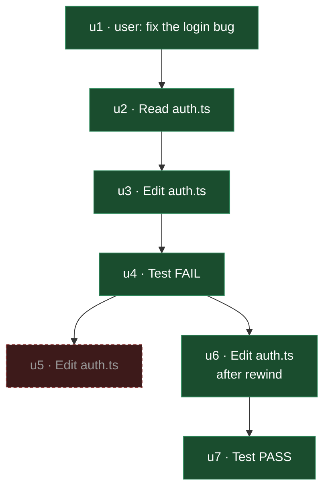
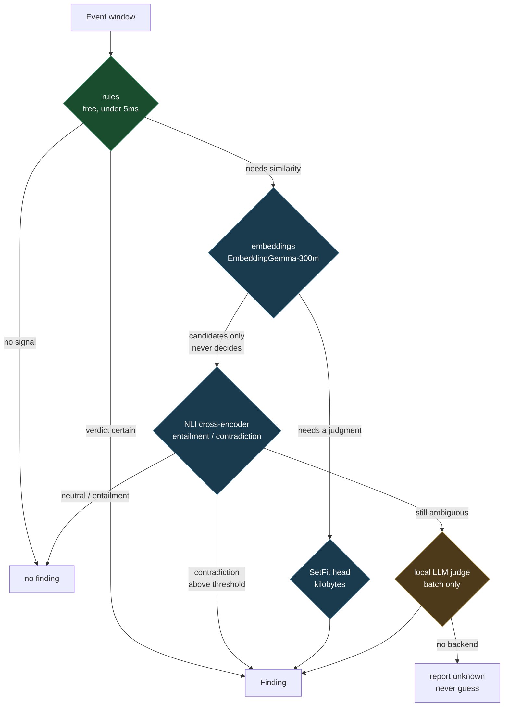
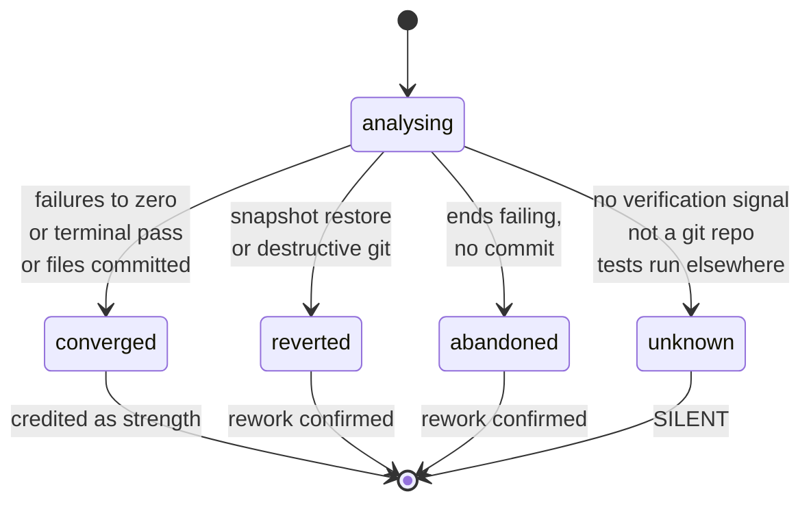
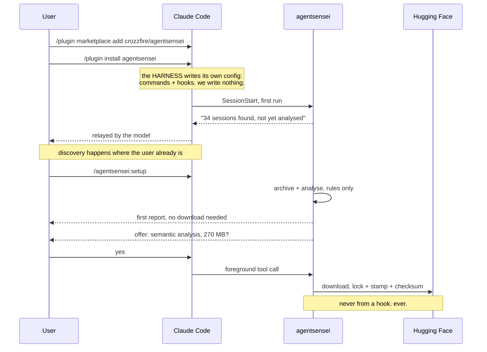
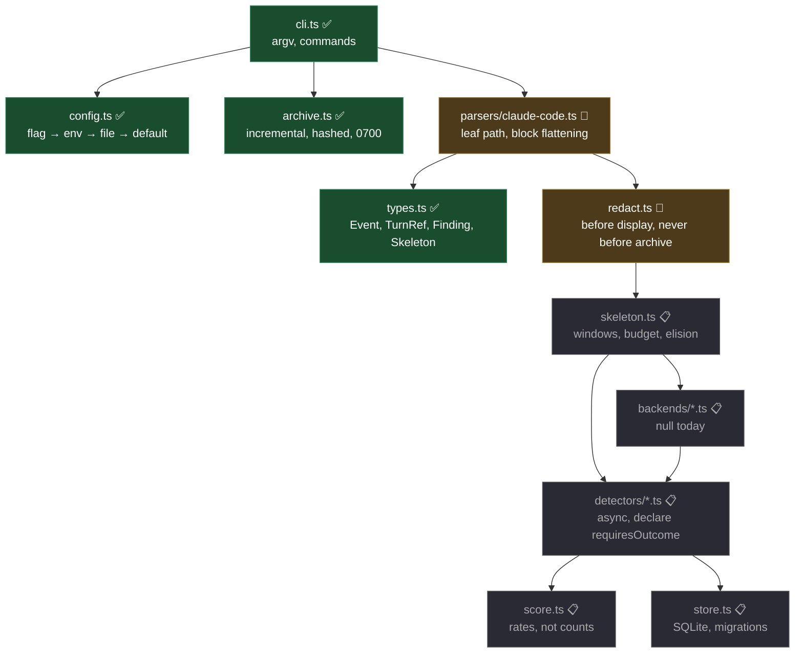

# Architecture

How the pieces fit, what each owns, and the invariants that must not be broken. Decisions and their
evidence live in [DECISIONS.md](../DECISIONS.md); this document is the mechanical view.

**Status legend:** ✅ implemented · 🔨 next · 📋 planned

---

## 1. The pipeline



**The one-way rule:** everything downstream reads the **archive**, never the live directory. The only
exception is `agentsensei now`, which tails the in-flight transcript because the current session is
still being appended to — the same incremental reader with a different source.

**Why the archiver comes first.** The harness deletes transcripts after 30 days by default
(`cleanupPeriodDays`). On the machine this was designed on, that had already removed 39 of 41
sessions. Preservation is not a feature of the analyzer; it is a precondition for having anything to
analyse.

---

## 2. A transcript is a tree, not a log

The single most consequential parser fact. Every record carries `parentUuid`; rewind and compaction
create branches that are no longer live.



`u5` is on an **abandoned branch**. Reading the file in line order would count both `u5` and `u6` as
edits, so a rework detector would see four edits where the user made three — inflating every
loop-shaped dimension with work that was discarded.

**Therefore:** reconstruct the active leaf path first, then index. `seq` is a position on *that path*
and is recomputed on every read. Evidence is stored by `uuid`, never by `seq` — see
[contracts.md](contracts.md).

**Sidechains** are the sibling problem: subagent events are interleaved into the same file
(`isSidechain`). A parallel fan-out legitimately reads the same files many times, so sidechain events
are attributed to their subagent and excluded from main-thread windows, or `reading_spiral` fires on
every healthy fan-out.

---

## 3. Hook lifecycle and the producer/consumer queue

Analysis never runs inside a hook. A hook's job is to move bytes and exit.


**Why the queue exists.** A `Stop` hook has a timeout budget, so blocking it to run detectors would
add latency to every single response. Instead the hook *drains* whatever the previous worker finished
and *spawns* a new one. A window analysed during turn 14 surfaces at turn 15's boundary — which is
also why batching is honest rather than a limitation: a finding is about a *window*, and the window
has to close before the finding exists.

**Why the statusline and not hook output.** Hook stdout lands in the **model's** context, not the
user's terminal — verified in a real transcript, where mem0's own `SessionStart` hook has to *ask the
model to print for it*. Injecting findings into the agent's context would also perturb the session
being measured, so the statusline is the only channel that both reaches the user and leaves the
measurement intact.

---

## 4. The detection cascade

Escalate only on ambiguity. Every tier is optional; the `core` nine need none of it.



**Embeddings shortlist; NLI decides.** Cosine similarity measures *topic*, not logical relation:
`cosine("use pnpm, never npm", "ran pnpm install")` is high, which would be a false positive. An NLI
cross-encoder answers the real question — premise vs hypothesis → entailment / neutral /
contradiction — and is correct in both directions. This is enforced in the detector interface, not
left to discipline.

The judge tier is drawn dashed on purpose: both of its dimensions are entailment questions, so it may
be deleted before it is written.

---

## 5. Outcome classification



**The fourth state is the entire safety mechanism.** `rework_loop` fires only on `abandoned` or
`reverted` — on `unknown` it does not fire at all. Treating "could not determine" as "did not
converge" would fire on every project without tests, every uncommitted branch, and everyone who runs
tests in a second terminal. Those are **invisibility, not rework**, and conflating them is the false
flag that destroys trust.

Consequence accepted openly: on a repo with no test suite, `rework_loop` is silent, and the output
says so rather than implying a clean bill of health.

---

## 6. Onboarding



**Statusline is the one thing a plugin cannot install for itself** — verified across all 26 official
plugins, none ship one, because `statusLine` is a `settings.json` field rather than a plugin
capability. So it needs a consented write, and `setup` is where that is asked.

---

## 7. Module map



| Module | Owns | Must not |
|---|---|---|
| `config.ts` ✅ | path resolution, sync-root detection | hardcode any path |
| `archive.ts` ✅ | incremental copy, offsets, hashes, 0700 | redact, parse, or write to sources |
| `types.ts` ✅ | the three pinned contracts | change shape without a version bump |
| `parsers/*` 🔨 | leaf-path reconstruction, block flattening, sidechain attribution | crash on an unknown record type |
| `redact.ts` 🔨 | secrets, paths, identifiers | run before archiving — the archive is raw by design |
| `skeleton.ts` 📋 | windowing, token budget, elision records | silently drop the decisive turn |
| `detectors/*` 📋 | one dimension each, async, declares `requiresOutcome` | emit on `EMB` alone without an NLI verdict |
| `score.ts` 📋 | rates, deltas, polarity, suppression labels | show a percentage below the minimum denominator |
| `store.ts` 📋 | SQLite, migrations, incremental writes | store raw events — they are re-derived |

---

## 8. Invariants

Enforced in code and asserted in tests, not left to discipline.

| # | Invariant | Where |
|---|---|---|
| I1 | A hook exits 0 unconditionally, always | every `scripts/` entrypoint |
| I2 | No hook ever downloads, under any config | model loader |
| I3 | Nothing is written to the user's harness config without printed, per-item consent | `init`, `fix --guard` |
| I4 | Nothing surfaces mid-response; the statusline is the only ambient channel | queue + statusline |
| I5 | The archive is raw; redaction happens at parse/display | `archive.ts` has no redactor import |
| I6 | The archive is 0700 and never inside a sync root | `initArchive` |
| I7 | Evidence is keyed by `uuid`, never by position | `TurnRef` |
| I8 | Finding identity is keyed on subject, never on evidence extent | `subjectId` |
| I9 | `unknown` suppresses a finding; it never becomes a guess | outcome classifier |
| I10 | A re-run reads zero redundant bytes | `archive.test.ts` ✅ |
| I11 | The whole pipeline runs against fixture dirs, touching no real home path | tests ✅ |
| I12 | Embedding similarity alone can never emit a finding | detector interface |

---

## 9. Current state

```
✅  config.ts        path resolution + sync-root refusal
✅  archive.ts       incremental archiver, 14 tests passing
✅  types.ts         TurnRef, Finding, Skeleton, Backend
✅  cli.ts           archive · doctor · config
🔨  parsers/claude-code.ts
🔨  redact.ts
```

Verified against real data: 3 transcripts, 5.0 MB archived; second run reads **0 bytes**.

Next is **M1** — parser, redactor, skeletonizer — then **M2a**, which is the first point the product
exists: eight outcome-free detectors, incremental persistence, and the running score.
