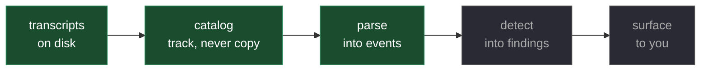
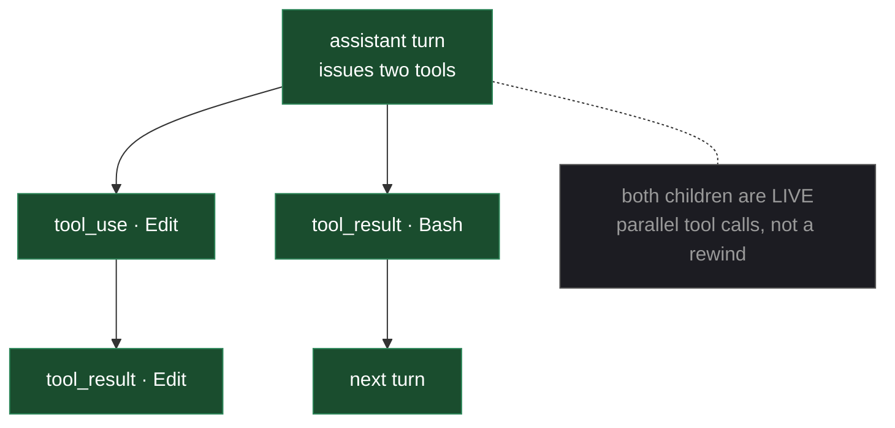
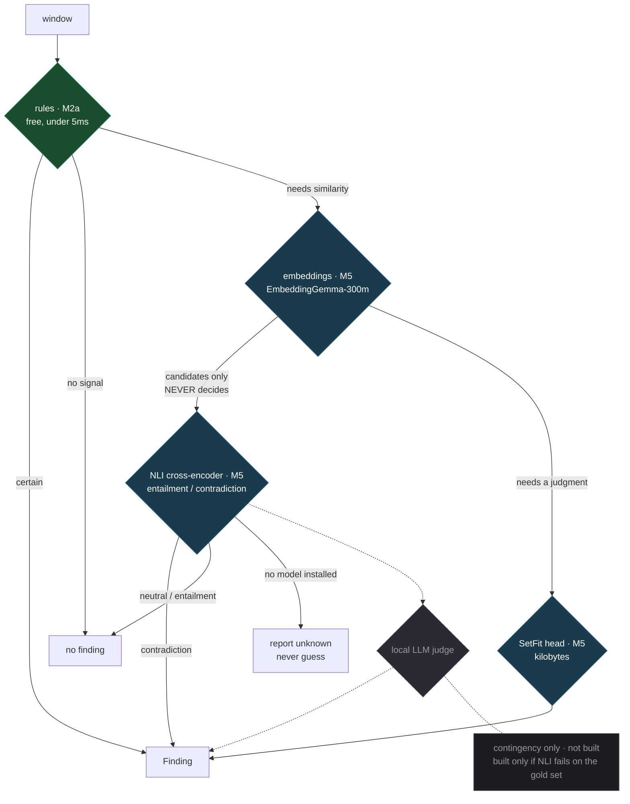
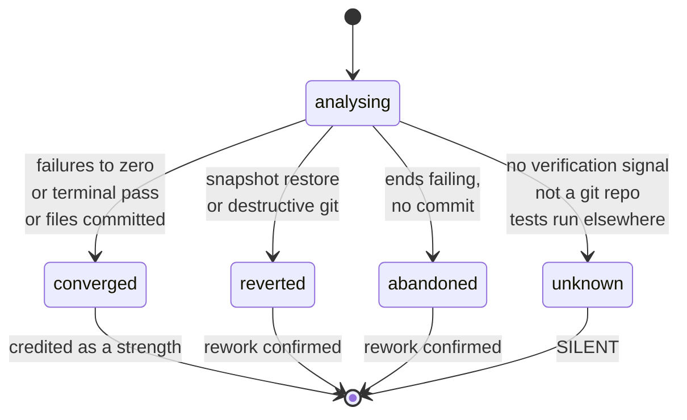
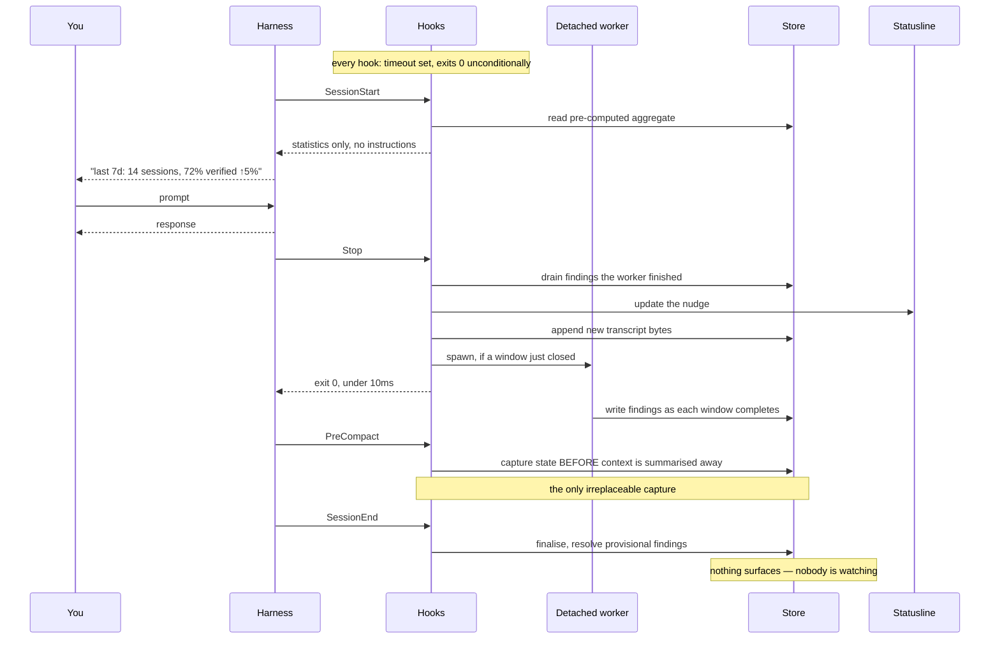
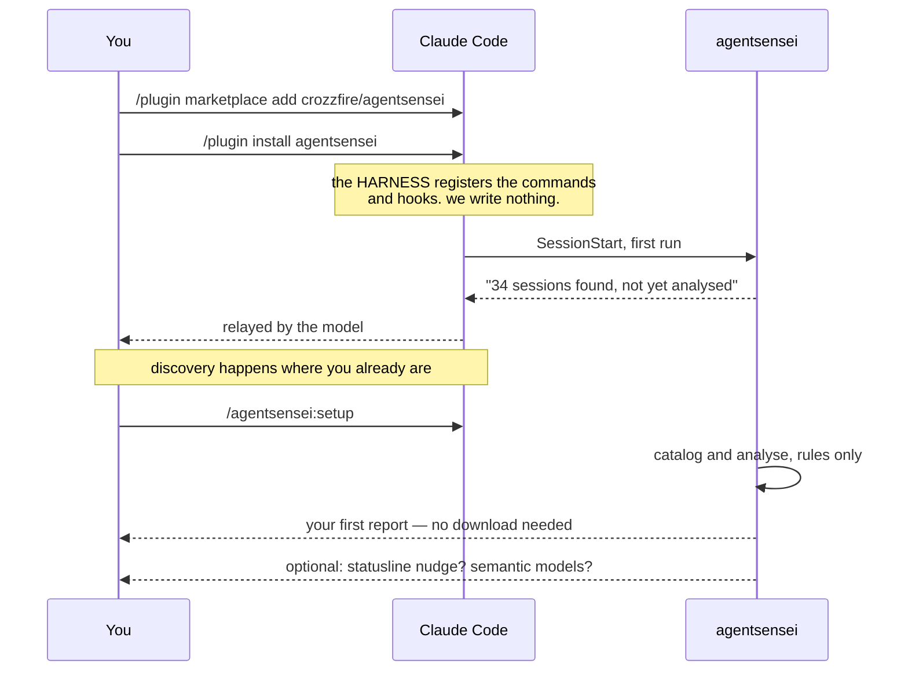
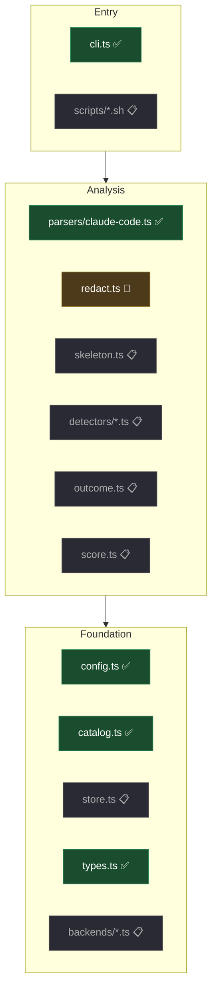

# Architecture

This document explains how `agentsensei` works, for someone seeing it for the first time. It is
meant to be read start to finish — about fifteen minutes — after which the code should be navigable.

It covers **mechanism**. The reasoning behind each design choice lives in
[DECISIONS.md](../DECISIONS.md), which is linked wherever a decision is load-bearing.

**Status markers:** ✅ built and tested · 🔨 in progress · 📋 designed, not built

---

# Part I — Orientation

## What this is

`agentsensei` reads the transcripts your AI coding sessions already leave on disk, finds the turns
where you and the agent wasted effort, and shows you the evidence — the exact turns, verbatim.

It produces exactly two kinds of output, and never a third:

- **Evidence.** "You told it to use pnpm at turn 3; it ran `npm install` at turns 31, 44 and 58."
- **Something you can apply.** A prompt that hands the cleanup to your agent, a hook that makes the
  mistake impossible, or a diff for your rules file.

It does not give advice, and it does not produce a score. Everything it says points at specific
turns. Where there is nothing you can apply, it says so rather than inventing a suggestion.

Everything runs on your machine, and the default experience needs no model download, no account and
no network access.

**One amendment, which is real rather than a technicality.** The opt-in judge
([below](#the-judge)) sends redacted transcript text to a model through your own Claude Code CLI.
It is off by default, enabling it takes two deliberate steps, and nothing is sent until you do —
but "no network access at all" was true of an earlier design and is not true of this one, so the
sentence is amended rather than quietly kept.

## Vocabulary

Nine terms do most of the work in this document.

| Term | Meaning |
|---|---|
| **harness** | The tool running the agent — Claude Code, Codex, Cursor. `agentsensei` reads what a harness writes. |
| **session** | One continuous conversation with an agent. The unit a developer recognises. |
| **transcript** | The JSONL file a harness writes for a session, one record per line. Our raw input. |
| **turn** | A single step in a session: a user message, an agent reply, a tool call, or a tool result. |
| **event** | One turn after parsing — normalised into the same shape regardless of harness. |
| **window** | A slice of 6–12 consecutive turns. Detectors look at windows, not whole sessions. |
| **skeleton** | A window with the bulk stripped out — no file contents, no long output. Roughly 5–10% of the original size. |
| **dimension** | One measurable pattern, e.g. `edit_retry`. [dimensions.md](dimensions.md) holds what is detected and measured; [archive/dimension-survey.md](archive/dimension-survey.md) holds the 40-dimension literature survey it replaced. |
| **finding** | One occurrence of a dimension in a session, with its evidence attached. |
| **guard** | A generated hook that prevents or catches a mistake mechanically, instead of relying on anyone remembering. |

## The shape of the system

Five stages, in order. Everything in Part II is one of these explained properly.



**One rule governs the whole flow: nothing is ever copied.** Sources are read in place, from the
offset the catalog remembers, and only derived data is persisted.

Each stage below answers a question raised by the one before it.

---

# Part II — The journey of a session

## 1. Reading the data without copying it

*Where does the input come from, and what do we keep?*

Claude Code writes one JSONL file per session under `~/.claude/projects/`. We read those files in
place and **never copy them.**

That is a deliberate reversal. An earlier design archived every transcript into our own store,
justified by the harness deleting them after `cleanupPeriodDays` — on the machine this was designed
on, 39 of 41 sessions were already gone. Two things killed it.

**First, honouring the retention policy removed the benefit.** Outliving `cleanupPeriodDays` silently
overrides a decision the user made; if they chose 7 days for privacy, holding copies forever defeats
exactly that. But once we prune when the harness prunes, the copy never survives anything the
original would not. It bought nothing.

**Second, and the reason it is not coming back: a transcript can contain a leaked token.** An API key
pasted into a prompt, a `.env` echoed by a tool result. That exposure already exists in the harness's
file — *copying it creates a second one*, in a directory we chose, with a lifetime we chose, that the
user never asked for. If that copy is read by the wrong process, synced, or swept into a backup, the
breach is **ours**, from data that was not ours to duplicate.

Local-first usually means "nothing leaves the machine." Necessary, not sufficient: **the smallest
attack surface is the one that does not exist.**

So `agentsensei scan` ✅ keeps a catalog — bookkeeping, no content:

```
$XDG_DATA_HOME/agentsensei/
  index.json      per source: path, offset, size, mtime, sha256, version, gone
```

On this machine that is **4 KB**, where copying was 10.4 MB.

The offset is what makes scanning cheap enough to run on every session end: compare size and mtime
against the source, and if nothing changed read **zero bytes**. Asserted in the tests, not assumed.

Three details that are less obvious than they look:

- **The offset stops at the last complete line.** The harness may be mid-write, and consuming a
  partial record would skip it permanently — the parser discards it as malformed and the finished
  version is never re-read.
- **A same-length rewrite forces a full re-read.** We keep no copy of the old bytes to compare
  against, so an unchanged size with a moved mtime is treated as suspicious rather than as a touch.
  Appending to a JSONL always changes its size, so this costs nothing in practice.
- **A deleted source keeps its catalog entry**, stamped with when it vanished. Findings outlive
  transcripts, so `explain` needs to say *when the harness deleted it* rather than implying we lost
  it.

**What this costs, plainly: no history beyond the harness TTL.** Not by default and not by
configuration — the capability does not exist. What survives is *derived* data: findings, and
(from M1) the redacted skeletons `explain` prints. So the running score still spans months on a
7-day TTL; you just cannot drill into verbatim evidence for a session that has aged out.

We now have a catalog pointing at the sources. The next step is reading one correctly.

## 2. Reading a transcript correctly

*We have the files. Why can't we just read them line by line?*

Mostly we can — but not naively, and the reason is instructive. Every record carries a `parentUuid`,
so a transcript looks like a tree. The temptation is to walk it: reconstruct the "live" path and
ignore branches left behind by rewinds.

**Measured against real sessions, that would be a bug.** The longest path covers only **1,325 of
1,695** records, and walking it drops **46 real records** — 39 of them `tool_result`s.



Of 285 branch points in the live session, **zero were rewinds.** 244 were an `attachment` sitting
beside a real record, and 39 were **parallel tool calls** — when the agent issues several tools in one
turn, an `assistant` `tool_use` and a `user` `tool_result` legitimately share a parent. Both sides are
part of the conversation.

So **file order is authoritative**: it covers 100% of records and is already topologically sorted —
zero parent-after-child violations.

**`parentUuid` still earns its place, though — rewinds are real.** Confirmed by rewinding a session on
purpose: the abandoned records stay in the file, **unmarked**, and in that session they were 38 of 71.
Since the last record is always on the live path, walking up its parent chain gives the live spine;
a sibling subtree off that spine is abandoned **if it contains a human prompt** — which a rewind's
dead branch does and a parallel tool call's `tool_result` stub never does. Those records are flagged
rather than dropped, and detectors ignore them by default.

That matters because the dropped records were `tool_result`s — and a `tool_result` is where the
harness records whether a call failed and who refused it. `edit_retry` reads exactly that. The bug
would not have crashed; it would have produced confident wrong findings.

Three more wrinkles in the same file:

- **`attachment` records sit *inside* the chain, not hanging off it.** Filtering them before walking
  the tree orphans everything beneath — it turns 1 root into 305. They are traversed through and
  skipped only when emitting events. At 710 of 2,336 records they are the single most common type, and
  almost entirely hook noise.
- **Tool calls pair by `tool_use_id`,** not by tree position.
- **Exit codes are asymmetric.** `Exit code N` appears only on *failure*; success carries no prefix.
  So a missing exit code means "succeeded, or not a shell command" — never "unknown". Inverting that
  would make `error_ignored` fire on every file read.

Subagent turns are marked `isSidechain`, and are attributed to their subagent so a parallel fan-out
does not read as a reading spiral. That field was `false` in all 1,695 records here, so the handling
is written but **not yet validated against real sidechain data** — one of the few claims in
[log-formats.md](log-formats.md) still marked *inferred*.

One more trap in the same vein: a `user` record with *string* content is usually a human speaking —
but `<command-name>`, `<local-command-stdout>` and friends are **slash-command echoes**. 13 of 69
across three sessions, and one session was 8 of 8: it looked like eight prompts and contained none.
They are emitted as `local_command`, because counting them inflates every per-prompt rate.

Unknown record types are counted and skipped, never fatal. Verified across all sessions: **0 unknown,
0 malformed**.

We now have a clean, ordered event stream. Next: what does a detector actually look at?

## 3. Making sessions comparable

*We have events. What is the unit of analysis?*

Not whole sessions — they vary from three turns to three hundred, which makes them useless for
comparison. The unit is a **window** of 6–12 consecutive turns, reduced to a **skeleton**: the shape
of what happened, with the bulk removed.

```
U  fix the login bug
→  Read auth.ts
→  Edit auth.ts (60 lines)
✗  Test FAIL (3) "token undefined"
→  Edit auth.ts (55 lines, ~80% similar)
✗  Test FAIL (3) same error
U  it's still broken                      [correction]
```

That is roughly 5–10% of the original tokens, and it is enough to see the pattern. Skeletons 📋 are
load-bearing in three places at once, which is why they are a pinned contract rather than an
implementation detail:

1. **Detector input**, and later model input — a window must fit a 4K-token prompt alongside a
   rubric and examples, so the budget is ~2K tokens.
2. **The evidence shown to you.** `agentsensei explain` prints the skeleton; it is not an internal
   format.
3. **The wire format for a future team feature.** So skeletons are redacted at construction — no
   file contents, no absolute paths, no identifiers — built as though they will be transmitted even
   though today they never leave the machine.

When a window exceeds its budget, lines are dropped by rule (agent prose first, then tool detail) and
**the elision is recorded in the output.** A skeleton that silently dropped the decisive turn would
produce a confident, wrong answer.

We now have comparable windows. Time to judge them.

## 4. Deciding what went wrong

*How does a window become a finding?*

Each of the 40 [dimensions](dimensions.md) is a detector that looks at a window and either produces
a finding, with evidence, or stays silent. They are tried in order of cost, and escalation happens
only when cheaper methods cannot answer.



> ⚠ **SUPERSEDED.** The three paragraphs that stood here described an
> embeddings → NLI cross-encoder → local-LLM cascade, with the local model as a
> contingency that would only be built if NLI failed. That design was replaced.
> What follows is what exists.

**Two tiers, not four.**

**Rules are structural**, and that is enforced by the type system rather than by discipline:
`StructuralEvent` is `Omit<Event, 'command' | 'pattern' | 'textSummary'>`, so reading text inside a
detector is a compile error. When a rule fires, the condition is literally true in the transcript —
the harness itself said so, in an error field or an exit code.

Two rules ship: `edit_retry` and `redundant_call`. Not nine. The gap between those numbers is
[`GRAVEYARD.md`](../GRAVEYARD.md), which holds ten detectors that were built, measured and deleted.

<a id="the-judge"></a>
**The judge reads conversation, and it is opt-in.** The structural well is dry, and that was
measured rather than assumed: Edit and Write account for 998 of roughly 1,400 tool refusals in the
public corpus, and `edit_retry` already covers both.

It is a model behind the `Backend` interface — but a hosted one through the user's own CLI, not the
local NLI cascade this section used to describe. The reason is the strongest evidence in the repo:
`inaccurate_self_report` was first built as a rule and died at **0 true positives against 5 false**.
The same dimension works as a judge dimension. Same target, different tier, opposite outcome.

Both tiers remain optional, and the original closing sentences still hold: a missing tier removes
dimensions and never degrades the ones that remain, and when something cannot be determined that is
reported rather than guessed.

Which raises the hardest question in the system.

## 5. Knowing whether it mattered

*We saw a loop. Was it actually waste?*

Four edits to the same file with tests failing in between looks identical whether the session was
flailing or converging. The only thing that separates them is **how it ended** — so the loop-shaped
dimensions cannot be judged until the outcome is known.



**The fourth state is the entire safety mechanism.** `rework_loop` fires only on `abandoned` or
`reverted`. On `unknown` it does not fire at all.

The temptation is to treat "could not determine" as "did not converge" — and that would fire on every
project without a test suite, every branch left uncommitted, and everyone who runs their tests in a
second terminal. None of those are rework; they are **invisibility**. Conflating the two produces
exactly the false flag that makes someone uninstall a tool and never say why.

The accepted cost: in a repo with no tests, `rework_loop` stays silent, and the report says
`outcome unknown — no verification signal in this project` rather than implying a clean bill of
health.

We now have findings worth trusting. The last problem is getting them in front of you.

## 6. Telling you, without getting in the way

*Findings exist. How do they surface during a live session?*

Under one hard constraint: **nothing may interrupt you.** The worst acceptable outcome is that a
nudge goes unnoticed. Analysis therefore never runs inside a hook — a hook's job is to move bytes and
exit.



**The queue is what keeps hooks fast.** A `Stop` hook runs after every single response, so running
detectors inside it would add latency to all of them. Instead it drains whatever the previous worker
finished and spawns a new one. A window analysed during turn 14 surfaces at turn 15 — which makes
batching honest rather than a limitation, since a finding is *about* a window and the window has to
close before the finding exists.

**The statusline is the only ambient channel**, and the reason is counter-intuitive: hook output does
not reach your terminal. It is injected into the *model's* context. (Verified in a real transcript —
mem0's own `SessionStart` hook has to ask the model to print on its behalf.) Beyond being the wrong
destination, injecting findings into the agent's context would change the session we are measuring.
So the statusline, which is passive and waits to be looked at, is the only channel that reaches you
while leaving the measurement intact.

`PreCompact` deserves its label. Compaction is exactly when context decay happens, and also when the
evidence for it gets summarised away — so capturing before it runs is the one thing no retrospective
tool reading finished transcripts can do.

**`SessionEnd` surfaces nothing**, because nobody is watching. Its job is finalisation: outcomes are
finally knowable, so every provisional finding resolves — and an in-flight loop that turned out fine
is *discarded* having never been shown. Findings wait in the store and appear at the next session
start, or whenever you ask.

That completes the path from a file on disk to a line you read. What remains is how you get it.

---

# Part III — Using it

## Installing

The harness is the primary surface; the CLI is secondary. Installation is two slash commands, and
**Claude Code writes its own configuration** — which is why this path is preferred over any installer
of ours.



Two things about this flow are deliberate.

**The first `SessionStart` is the onboarding moment.** It notices there is no catalog yet
and says so once, then never again. No README required, no CLI invocation — the tool introduces
itself where you already are.

**The statusline is the one thing a plugin cannot install for itself.** `statusLine` is a
`settings.json` field rather than a plugin capability — none of the 26 official plugins ship one — so
it needs a consented write, and `setup` is where that gets asked. The optional semantic models are
offered here too; their download mechanics are in [models.md](models.md).

Everything else is daily use: `/agentsensei:now`, `:fix N`, `:report 7d`, `:why N`, plus the
statusline. The CLI mirrors all of it for CI and scripting.

---

# Part IV — Reference

## Where the code lives

Layers, top to bottom. Arrows are dependency direction.



| Module | Owns | Must not |
|---|---|---|
| `config.ts` ✅ | path resolution, sync-root detection | hardcode any path |
| `catalog.ts` ✅ | incremental offsets, hashes, versions, vanished-source tracking | **copy a transcript**, redact, parse, or write to sources |
| `types.ts` ✅ | the three pinned contracts | change shape without a version bump |
| `cli.ts` ✅ | argv, command dispatch | contain analysis logic |
| `parsers/*` ✅ | file-order sequencing, block flattening, noise skipping, sidechain marking | crash on an unknown record type, or drop a `tool_result` |
| `redact.ts` 🔨 | secrets, paths, identifiers | let unredacted content reach the store |
| `skeleton.ts` 📋 | windowing, token budget, elision records | silently drop the decisive turn |
| `detectors/*` 📋 | one dimension each, async, declares `requiresOutcome` | emit on embedding similarity alone |
| `outcome.ts` 📋 | the four-state classifier | return anything but `unknown` when undetermined |
| `score.ts` 📋 | rates, deltas, polarity, suppression labels | show a percentage below the minimum denominator |
| `store.ts` 📋 | SQLite, migrations, incremental writes | store raw events — they are re-derived |

## Invariants

Enforced in code and asserted in tests, not left to discipline.

| # | Invariant | Where |
|---|---|---|
| I1 | A hook exits 0 unconditionally, always | every `scripts/` entrypoint |
| I2 | No hook ever downloads, under any configuration | model loader |
| I3 | Nothing is written to your harness config without printed, per-item consent | `init`, `fix --guard` |
| I4 | Nothing surfaces mid-response | queue; drained at a `Stop` boundary. ⚠ The statusline this invariant named was built and then deliberately removed ([D58](../DECISIONS.md)) — it cost a permanent row of screen for one rarely-changing number |
| I5 | **No transcript is ever copied.** `catalog.ts` writes nothing under the store but `index.json` | `catalog.test.ts` ✅ |
| I6 | The store is `0700` | `initCatalog` ✅ |
| I7 | Evidence is keyed by `uuid`, never by `seq` | `TurnRef` ✅ |
| I8 | Finding identity is keyed on subject, never on evidence extent | `subjectId` ✅ |
| I9 | `unknown` suppresses a finding; it never becomes a guess | `outcome.ts` |
| I10 | A re-scan reads zero redundant bytes | `catalog.test.ts` ✅ |
| I11 | The whole pipeline runs against fixture directories, touching no real home path | tests ✅ |
| I12 | Embedding similarity alone can never emit a finding | detector interface |

## What is built today

```
✅  config.ts      path resolution
✅  catalog.ts     incremental scan, copies nothing — 22 tests
✅  types.ts       TurnRef, Finding, Skeleton, Backend
✅  schema.ts      versioned persisted shapes
✅  parsers/       factory: harness + version dispatch — 17 tests
✅  cli.ts         scan · doctor · config
🔨  redact.ts
```

Verified against real data: 4 transcripts across 4 harness versions, **0 bytes copied**, a 4 KB
catalog, a second scan reading **0 bytes**, and events parsed with **0 unknown record types and 0
malformed lines**.

Next is the redactor, then **M2a** — eight rule-based detectors, incremental persistence
and the running score. That is the first point at which the product exists for a user rather than
for its authors. [PLAN.md](../PLAN.md) has the milestone detail.
