This page explains how the judge turns a session into findings, and what stops
a wrong or leaky result. The judge is one model, Claude Haiku by default,
called through your own `claude` CLI. The `Stop` hook starts it in the
background ([Phases of a run](/vibesenpai/architecture/phases/)).



## Why two stages?

Each batch makes two calls to the same model:

- **Stage A never sees the categories.** It reads the sessions and describes
  each episode where the collaboration broke down: what was said, what
  diverged, and a verbatim quote.
- **Stage B never sees the transcript.** It reads stage A's records and gives
  each a dimension.

Splitting them raised session-level agreement from **129/232 to 165/232**
([docs/eval.md](https://github.com/vibesenpai/vibesenpai/blob/main/docs/eval.md)).
Stage B is cheap: a record is a few hundred tokens, not a whole session.

The output puts `reasoning` **before** `dimension`, so the model reasons toward
a label instead of justifying one it already wrote.

A label may add **up to two** secondary dimensions, because the kinds overlap.
The main dimension decides the finding's id, the lookback gate, and its fix.

## Why quotes, not turn numbers?

Every record must carry a verbatim quote. A quote can be checked: it is either
in the packet sent to the model or it is not. A finding whose quote is not
found is **discarded**.

## What is the lookback gate?

A `misread_intent` or `constraint_violation` finding must cite where the
expectation was set **before** the agent acted:

- an earlier prompt
- an instruction Claude Code loaded (a `CLAUDE.md` or a rule file)
- the developer referring to an earlier decision

Stage B is shown the session's earlier prompts and loaded instructions for
this. The gate checks the cited quote against them. A finding with no earlier
source is dropped as a suggestion, not a mistake, and the run records how many
were dropped. The gate is on by default (`src/judge/lookback.ts`).

## How are sessions batched?

- Each model call carries about **26k tokens of fixed overhead**
  (`src/judge/limits.ts`), and each batch pays it twice.
- So whole sessions share a batch while it stays under **60,000 tokens**.
- A pass sends up to **3 batches at once**.

A session too big for one batch is **read in windows**, in order. Each window
carries what came before: failures still open, findings already reported, and
how many turns were read. Prompts are never truncated, so a prompt too big
for any batch is read in parts, by character range.

## How does it know what it has read?

The `ledger` table in `store.db` holds, per session, **how many bytes have been
read**. A live session keeps growing, so a session read at turn 50 is read again
from there at turn 100.

Progress and cost are kept apart:

- **Spend is recorded when a call returns**, whatever happens next: it was paid
  for.
- **The ledger moves only with the findings**, in the same transaction. If
  stage B fails, those bytes are read again on the next pass. A failure costs
  tokens again; it never loses episodes.

## Where is redaction applied?

Four times:

1. **In the parser**, as events are built. Nothing downstream holds raw text.
2. **Inside truncation**, by moving the cut. Cutting through a `[USER]` marker
   would leave `/Users/[USER`, which redaction would rewrite, so the
   packet would fail the final check.
3. **At the end of packet assembly**, because joining two clean pieces can
   create a secret-shaped pattern.
4. **Immediately before each send**, as a check:

```
  redact(packet) === packet   or the send aborts
```

Both stages are checked separately: stage B sends a different string, even
though its quotes came from stage A's checked packet.

The check is equality, not "redacting twice gives the same answer". That
weaker test passes for text that redaction would still change.

## What stops a stale or runaway pass?

- **Fencing.** A pass holds a lease from the job supervisor. Before every model
  call and every write it checks it still holds it. A replaced pass, for
  example one reclaimed as hung, sends and writes nothing more.
- **Isolation.** The model runs in a child process with:
  - `VIBESENPAI_DISABLE=1`, so the child's own hooks do nothing
  - a working directory that transcript discovery skips, so the judge never
    reads its own sessions as yours
  - `--allowed-tools ''`, so it can read and answer but cannot act
