The shape of this tool is easier to hold once you know two things that a
straight-line diagram would get wrong.

**It is not one pipeline.** Four commands read transcripts, and they differ in
how bytes get off disk, not in what happens afterwards. `now` reads one live
session. `report` walks many. The standing pass runs detached and reads
everything. The judge reads full text that the others never see.

**The catalog is a side-branch, not a stage.** `scan` records byte offsets and
hashes so a re-read is cheap, and `doctor` reports on it. Neither `now`,
`report`, the standing pass nor the judge consult it. If you came here
expecting an index that everything queries, there isn't one — findings are
re-derived from the source every time.

## The spine

| | |
|---|---|
| **read** | byte ranges, in place. Never opens a source for writing |
| **parse** | JSONL → events, in **file order**. [Why not the tree →](/vibesenpai/architecture/reading/) |
| **redact** | here, at construction — not before display, not before sending |
| **detect** | structure only. [The compiler enforces it →](/vibesenpai/architecture/two-tiers/) |
| **findings** | identity, dedup, and the count that makes a finding stable |

## Two deliberate omissions

**Nothing is stored that could be re-derived.** There is no database of events.
A finding is computed from the transcript each time, which costs a parse and
buys the guarantee that a stale index can never produce a stale finding.

**No aggregate is a finding.** A session-wide ratio has no turn to point at,
and everything this tool says must point at a turn. Ratios and token counts
appear as *context* beside findings, never as findings.

## Where to go next

- **[Phases of a run](/vibesenpai/architecture/phases/)** — when each part
  fires, and why nothing slow happens in a hook
- **[Reading a transcript](/vibesenpai/architecture/reading/)** — the no-copy
  rule, and the tree-walk that would have been a silent bug
- **[The two tiers](/vibesenpai/architecture/two-tiers/)** — rules and the
  judge, and why one of them cannot read text
