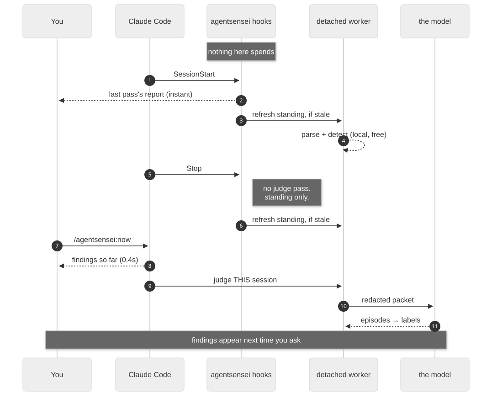

Two hooks start everything. Neither waits for analysis.

## Nothing slow happens in a hook

Each hook has a 5-second timeout and exits 0 whatever happens (`|| true` in
`hooks/hooks.json`). A hook checks which background jobs are due, starts them as
detached processes, and exits. The analysis happens in those processes.

So what you see at the start of a session is the **last completed pass**, not
one computed while you waited.

## Only the Stop hook spends

| phase | what it does | spends? |
|---|---|---|
| `SessionStart` | shows the last pass's summary as a `systemMessage`; starts the standing pass if stale | no |
| `Stop` | starts the standing pass if stale, and the judge if due and within limits | **yes**, within limits |
| `/vibesenpai:insights` | reads what the passes stored | no |
| `/vibesenpai:report` | writes the HTML report from what the passes stored | no |
| `/vibesenpai:judge on` / `off` | changes a setting | no |

The judge is due when the live session has about 50 new turns since it was last
read, or when a past session inside the catch-up has never been read. The `Stop`
hook gives it two limits (`src/judge/limits.ts`):

- **2M tokens a day.** If what is left today cannot cover even an empty batch,
  no pass is started.
- **A catch-up of 200 past sessions**, newest first, fixed the first time the
  pass runs.

[What is sent, and what it costs →](/vibesenpai/start/sends-and-costs/)

## Jobs heal at the next hook

Every background pass runs under a supervisor (`src/supervise/`). A pass holds a
lease, sends a heartbeat, and ends itself at its deadline. The next hook that
runs that job reclaims a pass that died or hung (for the judge, the `Stop`
hook). A live process is never reclaimed on time
alone.

The judge checks it still holds its lease **before every model call and every
write**, so a pass that was superseded sends nothing more.

When a pass fails:

| kind of failure | what happens |
|---|---|
| **free** (nothing was billed) | backs off and retries: 5 minutes, 30, 2 hours, 12 hours, then every 24 hours, for ever |
| **paid** (a model call was billed) | backs off the same way; after **3 in a row**, the judge holds until `/vibesenpai:judge on` |

One success clears the count. A job that is failing is stated at session start
as one plain fact.
