This page explains how vibesenpai reads Claude Code's transcript files: why it
never copies them, where secrets are removed, and why it reads records in file
order.

## Why is nothing copied?

A transcript can contain a secret: an API key pasted into a prompt, or a `.env`
file printed by a tool. That exposure already exists in Claude Code's file.

A copy would create a second one, in a place and for a lifetime vibesenpai
chose, which you never asked for. So:

- Transcripts are read in place, by byte range, and never opened for writing.
- What is stored is derived: **byte offsets and hashes** to know what has been
  read, and findings with their turn anchors and short quotes, **redacted when
  written** (`store.db`, see [Reference](/vibesenpai/reference/)).
- The conversation the pane shows around a finding is read from the transcript
  each time, redacted, and not kept.

**The cost:** no history beyond Claude Code's own retention. When Claude Code
deletes a transcript, that session is gone here too. An opt-in copy
was considered and rejected: it would bring back a copy writer, a cleanup loop
and file-permission checks that not copying avoids.

## When are secrets removed?

At construction. The parser redacts as it builds events, so nothing
downstream ever holds the unredacted text. Code built on top is safe by
default, not by remembering to redact.

Redaction covers secret-shaped text such as API keys, JWTs, bearer tokens and
credentials in URLs. In a transcript, tool output is where such text usually
appears.

## Why file order, not the tree?

Every record carries a `parentUuid`, so a transcript looks like a tree. The
obvious design is to walk the longest path and ignore side branches, on the
idea that side branches are what a rewind left behind.

That would be a bug.

The branch above is not a rewind. It is two parallel tool calls, which is
ordinary. Walking only the longest path drops one of them, including its
`tool_result`.

A `tool_result` is where Claude Code records whether a call failed and who
refused it, and `edit_retry` reads exactly that. Dropping them would not crash
anything. It would produce wrong findings with no visible error.

So events are read in **file order**. The tree is used only for attributing
subagent work (a sidechain, in Claude Code's terms): a subagent's records form
one subtree, so its topmost ancestor identifies the call that started it. The
pinned public corpus that `npm run verify:corpus` checks has 712 sidechain
events (`scripts/corpus.json`).
