This page explains vibesenpai's two kinds of check: the free checks, which read
only structure, and the model reads, where a model reads the conversation. The
judge is what does the model reads.



## How do the two tiers differ?

| | the free checks | the model reads |
|---|---|---|
| reads | structure: tool results, failure kinds, hashes, timestamps | the conversation text |
| confidence | `certain`, or `high` when a call clipped its own output: Claude Code recorded it | a model's reading |
| costs | nothing | your own quota, in the background, within 2M tokens a day |

Both show up the same way. The display does not say which tier a finding came
from; the method is kept in the data. The HTML report's footer says that most
findings are a model's reading and can be wrong.

## Why can a detector not read text?

A detector is the code behind one free check. It cannot read text because the
type it receives does not contain any:

```ts
export type StructuralEvent = Omit<Event, 'command' | 'pattern' | 'textSummary' | 'devCommand'>;
```

Those four fields come from text: the shell command, the search pattern, a
summary of prose or tool output, and a slash command you ran. `Omit`
removes all four, so `e.command` inside a detector **fails the build**. A test
asserts that `command`, `pattern` and `textSummary` stay unreachable.

The rule exists because detectors that read text did not work
([Contribute](/vibesenpai/contribute/#how-do-i-add-a-detector)).

## What does a detector read instead?

The parser is the only module that reads raw text. It turns text into closed
values a detector may use:

- `failureKind`, one of six values
- content hashes
- `truncatesOwnOutput`
- timestamps

For example, Edit retry counts only `failureKind === 'tool'`; it never reads
the error message to decide.

**A harness string may name a finding; it may never produce one.** Labels are
attached after a finding already exists. If Claude Code rewords an error
message, the label goes missing and the finding still fires.

## Why are there model reads at all?

Most failures that structure can show are already covered. In the public
SWE-chat sessions, Edit and Write account for **998 of about 1,400 tool
refusals**, and Edit retry already covers both.

The remaining failures show in what was said, not in exit codes. For example,
an inaccurate self report cannot be found from structure, and is found by the
model reads.

A model finding that cannot quote the text it came from is discarded.
[The judge pipeline](/vibesenpai/architecture/judge/)
