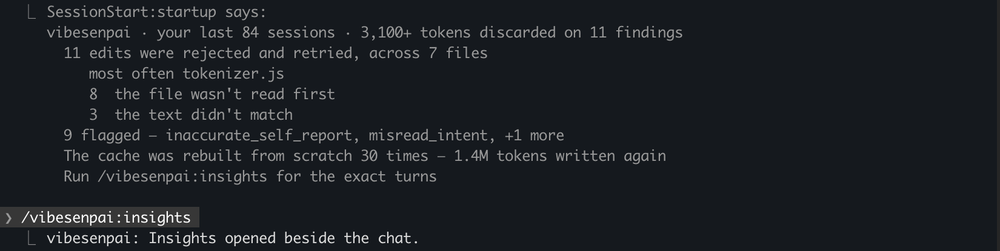

Opens the insights pane beside the chat: your findings, the fixes you can apply, and the health
of the history pass (which runs the free checks) and the model reads.

```
/vibesenpai:insights
```

It takes no arguments.

## What it does

It shows what the history pass and the model reads have already found. It sends nothing to a model and
spends no tokens; the model reads run only when a turn ends.



Claude Code prints `Insights opened beside the chat.` The pane stays open and refreshes when
there is something new. [A tour of the pane](/vibesenpai/start/pane/) describes every part of it.

## Where no pane can open

If Claude Code cannot place a pane, the command prints a text version instead:

1. the session you are in
2. your history
3. how far the model reads have got

From a demo run over the public test data of
[claude-code-log](https://github.com/daaain/claude-code-log) (MIT), after the model reads had
finished:

```
  This session · 0 edits

  Your history

    11 edits were rejected and retried, across 7 files
       most often tokenizer.js
    3 misread intent
    5 inaccurate self report
    1 other

  The cache was rebuilt from scratch 30 times — 1.4M tokens written again

  Analysis

    101 of 101 sessions read
    Up to date.

  Run /vibesenpai:report for more details
```

The text version has no Apply and no answers. Those are only in the pane.

## On an older Claude Code

The pane needs Claude Code 2.1.299 or later. On an older version the command shows no findings and
says so instead:

```
The insights pane needs Claude Code 2.1.299 or later. This session runs 2.1.290.
The latest installs with:

  claude update

The pane opens in the next session after that.

In the meantime, try /vibesenpai:report. It works on this version and opens your whole history as an HTML report, with every finding, its turns and its fix.
```

[`/vibesenpai:report`](/vibesenpai/commands/report/) does not need the pane, so it works on any
version the plugin installs on.

## Related

| | |
|---|---|
| [`/vibesenpai:judge`](/vibesenpai/commands/judge/) | turns the model reads on or off |
| [`/vibesenpai:report`](/vibesenpai/commands/report/) | the same findings as an HTML file |
| [Settings](/vibesenpai/reference/#settings) | which free checks run |
