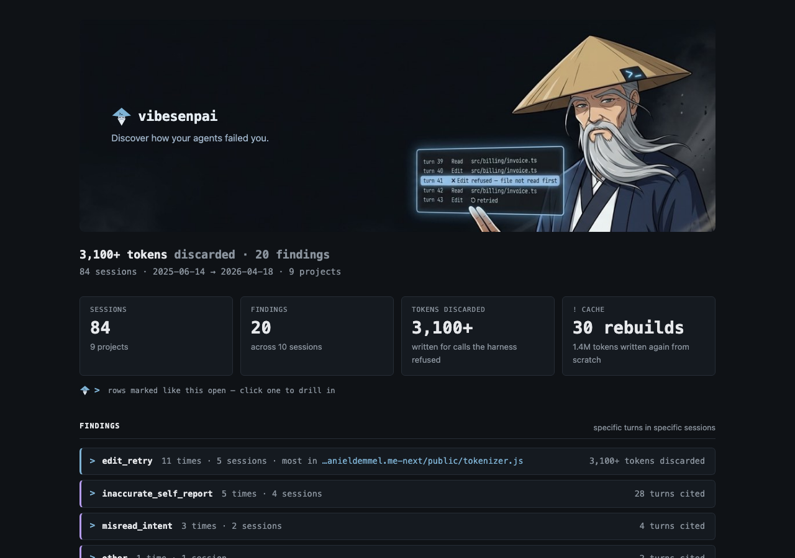

```
/vibesenpai:report
```

Writes an HTML report of your history and opens it in your browser. It takes no arguments.
The pane's **Open full report** button does the same.



## What you see

In Claude Code, from the demo data:

```
  84 sessions · 20 findings — opened in your browser
  ~/.local/share/vibesenpai/reports/2026-11-08-1727.html

  Run /vibesenpai:insights for the fixes, and Apply
```

If the browser could not be launched, it says so and gives the command that opens the file.
While model reads are still going, a line says how many sessions are left to read.

## What is in it

All of your history, not a date range:

- **The headline**: tokens discarded on refused edits and the number of findings, then the
  sessions, dates and projects covered.
- **Findings**: one block per kind, with how many times, in how many sessions, and the turns
  cited. Opened, each finding shows the prompt it answered, the quote, the model's account,
  and its fix.
- **Cache**: rebuilds only, each with its turn, the gap before it and what was written.
- **Sessions**: findings first, each with the prompts and turns that matter.
- **Coverage**: what was read, and what could not be.

## The file

| | |
|---|---|
| where | `~/.local/share/vibesenpai/reports/<date>-<time>.html`, in local time |
| mode | `0600`, in a `0700` directory |
| offline | one file. Images are embedded, nothing is fetched, and it opens without a network |
| script | one small inline script for the copy buttons, pinned by hash in the page's content security policy; nothing else runs |

It is written into the store, not your working directory, so it cannot end up in a commit by
accident. It holds quotes from your sessions.

## Related

| | |
|---|---|
| [`/vibesenpai:insights`](/vibesenpai/commands/insights/) | the same findings in the pane, with Apply |
| [Reference](/vibesenpai/reference/#files) | the store, and what losing each file costs |
