Claude Code keeps the conversation in a prompt cache. A rebuild is a request
that found the cache gone and had to write the whole conversation into it again.
The pane lists each rebuild and the tokens it wrote.

## The dimension

| | |
|---|---|
| In the pane | Cache rebuilt |
| Key | none: it is not a detector |
| Tier | free check, computed from token figures Claude Code records |
| On by default | yes, computed for every session; listed when a rebuild happened |
| Confidence | none. It is a fact about the session, never a finding or a score. |

## Description

Each model request reads the conversation so far from the prompt cache and
writes anything new to it. A rebuild is a request that found the cache gone and
wrote the whole prefix again.

Most cache figures are ordinary: totals grow with every session, and nearly
every request reads from cache. A rebuild is different, so it is the one cache
figure shown, and only when one happened
([Decisions](/vibesenpai/architecture/decisions/), D66).

What it is not:

- **Not a compaction.** A compaction replaces the conversation with a summary on
  purpose. A drop right after one is not counted.
- **Not a finding.** It has no confidence and no Hide button. It is listed
  beside the findings.

## Example conversation

From the public test data of [claude-code-log](https://github.com/daaain/claude-code-log) (MIT).

> **Developer**: "New feature: we support .zip, but I've seen an archive that contains embedded tar.gz. We should support those (.tar, .tar.gz) as well…"
>
> **Agent**: explores the code, asks the developer a question, writes a plan and
> asks for its approval, and edits the code, all in one long turn.
>
> **Turn 134**, inside that turn: a model request made 69 minutes after the
> previous one. The previous request had read 65,720 tokens from cache. This one
> found them gone and wrote 54,357.

In the pane, under **Cache rebuilt**, the rebuild is listed as:

```
turn 134 · a7da6a22 · 69 min after the previous request · 54,357 written
```

`a7da6a22` is the start of the session id. The summary line gives the number of
rebuilds and the tokens written again, and opening it lists the three largest.

## How it's detected

It reads only the token figures Claude Code records for each response, which
thread each response belongs to, compactions and timestamps. No message text.

Each response is counted once, on its own thread (the main conversation, or a
subagent). A request is a rebuild when all three hold:

1. The previous request on that thread read more than 20,000 tokens from cache.
   Below that, early turns swing too much to tell.
2. This request read less than half of that, and wrote to cache.
3. There was no compaction on that thread since the previous request.

Each rebuild is recorded with its turn, the tokens written, and the time since
the previous request.



## Applicable fixes

**There is no fix.** The only response to a rebuild after a long gap would be to
work in shorter sessions, and that is advice, which this tool does not give.
Claude Code's one-hour cache setting (`ENABLE_PROMPT_CACHING_1H`) is not offered
either: Claude Code lists it for API key, Bedrock, Vertex and Foundry users,
not subscriptions.
