## The dimension

| | |
|---|---|
| In the pane | Constraint violation |
| Key | `constraint_violation` |
| Tier | model read |
| On by default | yes, with the model reads (`/vibesenpai:judge off` turns them off) |
| Confidence | the model's own rating (high, medium or low), stored per finding |

## Description

An instruction was stated literally and visibly, and the agent did not follow
it. That covers prohibitions ("don't push"), allow-lists, a constraint repeated
more than once, and required process steps.

The rule can come from the developer's prompt or from a loaded instruction: a
project instruction file, a skill, or a slash command's written procedure. Before
that source restriction was dropped only a developer prompt counted (GRAVEYARD.md).
A skipped step in a command's procedure counts only if the developer objected or
the outcome changed.

What it is not:

- **Not [misread intent](/vibesenpai/dimensions/misread-intent/).** A misread is
  a request that left room, filled the wrong way. A violation is a rule with no
  room in it.
- **Not [overreach](/vibesenpai/dimensions/overreach/).** Doing more than asked is
  overreach unless a stated rule forbade it. Work that is both is labelled
  constraint violation with `also overreach`.
- **Not a new preference.** If the developer brings a new requirement to work in
  progress, the lookback gate drops it as a suggestion.

There is no per-dimension frequency from a source this site cites. Across all
model-read kinds, agreement with published labels is in
[How accurate it is](/vibesenpai/work/measuring/).

## Example conversation

:::note[Illustrative]
The demo data has no constraint violation finding. This exchange was written for
this page in the shape of a real transcript. It was not found.
:::

> **Developer**, turn 3: "Fix the failing lint step. Don't push anything; I'll review the diff first."
>
> **Agent**, turns 4 to 11: edits two files, runs the linter, then runs
> `git push origin lint-fix`.
>
> **Developer**, turn 12 (cited): "I said not to push. Please don't push until I've looked."

What the finding records:

| | |
|---|---|
| Why | The developer said not to push before reviewing, and the agent pushed the branch anyway. |
| Established | turn 3, "Don't push anything; I'll review the diff first." |
| Cited turns | 11, 12 |

The pane shows the developer's quote as the row's headline, then the
conversation around the cited turns and **Why**. The finding also stores where
the rule was established; the pane does not display that today, because a
source that is real but beside the point would read as evidence.

## How it's detected

The session is built into a packet and redacted. The extract stage finds
episodes without being shown any categories, each anchored by a quote that must
be found in the packet. The label stage then names the kind. The shared pipeline
is on [The judge pipeline](/vibesenpai/architecture/judge/).

What is specific to this kind is the **lookback gate**. A constraint violation
must name where the rule was set before the agent acted: an earlier prompt, a
line of a loaded instruction file, or the developer's own words saying it was
settled before. The code checks that quote against what was sent. If there is no
source, or the quote cannot be found, the record is dropped as a suggestion.



## Applicable fixes

A finding's own fix is shown first, under the finding. The dimension's fix is the
fallback, under the Constraint violation heading.

**The finding's own fix**, built from its evidence. The first rung the evidence
supports is offered:

| Kind, in the pane's words | When | What it adds | Where | Apply |
|---|---|---|---|---|
| Claude Code asks you before this command runs, in every mode: | the developer forbade a command's verb, and the agent ran it | `"Bash(git push *)"` in `permissions.ask` | `.claude/settings.local.json` | yes |
| Claude Code refuses an edit to this path and tells the agent why: | the agent wrote to a path outside the project | a `PreToolUse` hook on Edit, Write, MultiEdit and NotebookEdit that exits 2 for that path | `.claude/settings.local.json` | yes |
| A test that fails when this rule is broken: | the rule was already a loaded instruction | a request for a test, lint rule or type constraint; the agent shows it before adding it | a test or check in this project | yes |
| A rule the agent reads when it opens these files: | the rule was set in an earlier prompt, and 1 to 5 project files were written | `- Standing instruction from the developer: "<their words>"` with a `paths:` list | `.claude/rules/vibesenpai/<fix id>.md` | yes |
| A rule the agent reads in every session of this project: | the rule was set in an earlier prompt | `- Standing instruction from the developer: "<their words>"` | `.claude/rules/vibesenpai.md` | yes |

In the illustrative example above, the first rung applies: the pane would offer
`Bash(git push *)` for `permissions.ask`.

**The dimension's fix**, shown when the finding has none of its own:

> A rule the agent reads in every session of this project:
>
> Before any edit or command, check it against every constraint stated earlier in the conversation, and name the one you checked.

It is added to `.claude/rules/vibesenpai.md`, with one pointer line in
`CLAUDE.md`, and the pane offers Apply.

**Printed in the HTML report only, with no Apply** (`/vibesenpai:report`):

- A `Stop` hook that checks the diff before the turn can end, with a placeholder
  for the paths:

  ```json
  { "hooks": { "Stop": [{ "hooks": [{ "type": "command",
      "command": "git diff --name-only | grep -qE '<paths you said not to touch>' && { echo 'touched a path you asked me not to' >&2; exit 2; } || true" }] }] } }
  ```

- The same instruction as a prompt for one session: "For the rest of this
  session, before any edit or command: check it against every constraint stated
  earlier in this conversation, and say which one you checked against."
- When the conversation was compacted before the cited turn, the hook is replaced
  by a `SessionStart` hook with the `compact` matcher that runs
  `cat .claude/standing.md`, so standing instructions are read again after each
  compaction.

A Stop hook stays printed until each snippet is bounded and tested: one that exits
2 with an unfilled placeholder would stop every turn.
