Claude Code's edit tool refused one of the agent's edits, and the agent tried the
same file again. Each retry costs tokens, and the finding shows why the edit was
refused.

## The dimension

| | |
|---|---|
| In the pane | Edit retry |
| Key | `edit_retry` |
| Tier | free check |
| On by default | yes, in the default preset `core` |
| Confidence | `certain` on every finding |

## Description

The agent called an edit tool, the tool itself refused the call, and the agent
edited the same file again before your next prompt. The agent is working against
one of the edit tool's rules, such as reading the file first or matching the
text exactly.

What it is not:

- **Not a refusal you made.** A permission you declined, or your own hook
  blocking an edit, is your control working. It is never counted.
- **Not a single refusal.** If the agent accepts the refusal and moves on, the
  tool did its job. The retry is what makes it a finding.
- **Not a retry after a new instruction.** The attempt ends at your next prompt.

The most common reasons are an edit to a file that wasn't read first, and text that didn't
match. How often it fires is on [How it was measured](/vibesenpai/architecture/measurements/#the-free-checks).

## Example conversation

From the public test data of [claude-code-log](https://github.com/daaain/claude-code-log) (MIT).

> **Developer**: "The redirection doesn't work :( we might need to move it to @vercel.json ?"
>
> **Agent**, turn 74: Edit `vercel.json`
>
> **Tool**, turn 75: refused. The file has not been read yet.
>
> **Agent**: Read `vercel.json`
>
> **Agent**, turn 78: Edit `vercel.json`, which succeeds.

In the pane, the headline is your prompt. Opened, it lists the attempt, the
refusal and the retry in order, then the reasons: `1× not read first`.

## How it's detected

A free check reads the transcript's structure, never message text. This one
reads:

- calls to the four edit tools (Edit, Write, MultiEdit, NotebookEdit) and the
  file each one targets;
- each result: whether it is an error, and whether the tool raised it, or you or
  your hook did;
- the order of events, and where your next prompt falls.

It fires when the tool refused an edit, and another edit to the same file
follows before your next prompt.

The reason comes from the start of the tool's error message, such as "File has
not been read yet". The reason names the finding; it never decides it. A message
that is not recognised gives "reason unknown", and the finding stands.

## Applicable fixes

Edit retry has one fix at a time, chosen from the reasons across your findings.
The most common reason that has a fix decides it. Free-check findings have no
fix of their own.

**The text didn't match:**
- Adds: `- Re-read right before editing if anything may have changed the file.`
- Apply: yes.

**The file changed after it was read:**
- Adds: `- After a stale-read refusal, re-read before retrying the edit.`
- Apply: yes.

**The text matched several places:**
- Adds: `- Quote enough context to make an edit target unique.`
- Apply: yes.

Each rule lands in `.claude/rules/vibesenpai.md`, with one pointer line in
`CLAUDE.md`.

These reasons have no fix and are passed over: the edit changed nothing, the
file doesn't exist, the call was malformed, and reason unknown.

**The file wasn't read first is passed over too.** Claude Code already refuses an
edit to a file that was not read, which is why these were refused. A rule asking
for it would describe what already happens. So the most common reason that has
a fix is offered instead, even when "not read first" is more common. Only when
no other reason has a fix is there no fix: the pane shows the finding with no
fix, and the HTML report says "Nothing to change", with the tokens those
refusals cost.

In the public test data, "the text didn't match" is the most common reason with
a fix, so the pane offers "Re-read right before editing if anything may have
changed the file."

### Printed in the HTML report only

Each fix also has a prompt for one session, with no Apply. It appears in
`/vibesenpai:report`. For example: "For the rest of this session: before
editing, re-read the exact region you are about to change if anything may have
altered it since you last read it — a linter, a formatter, another tool, or your
own earlier edit."
