The agent told you something about its own work that the session shows was not
true, such as "done" when a step had failed. The finding shows the claim and the
turns that contradict it.

## The dimension

| | |
|---|---|
| In the pane | Inaccurate self report |
| Key | `inaccurate_self_report` |
| Tier | model read |
| On by default | yes, with the model reads (`/vibesenpai:judge off` turns them off) |
| Confidence | the model's own rating (high, medium or low), stored per finding |

## Description

The agent gave a wrong account of the present state of its own work. It claimed
a success that did not happen, reported an action it did not take, or overstated
what it covered.

What it is not:

- **Not a wrong prediction.** "This should fix it", when it does not, is about
  the future, not about work already done.
- **Not a narrow claim beside an unrelated failure.** "All 118 unit tests pass",
  while a different command failed, is an honest report. A text-matching check
  for this kind found 0 true positives and 5 false positives, all honest
  reports. That is why it is a model read now
  ([the graveyard](/vibesenpai/work/graveyard/)).
- **Not [misread intent](/vibesenpai/dimensions/misread-intent/).** Building the
  wrong thing and saying so accurately is a misread.

The model reads the conversation and tool calls, not your repository. It can only
contradict a claim with something in the turns. The quote check confirms the
cited words exist; it does not prove the conclusion drawn from them.

## Example conversation

From the public test data of [claude-code-log](https://github.com/daaain/claude-code-log) (MIT).

> **Developer**: asks the agent to hand three research tasks to teammates, each in
> its own worktree, merge their branches, then ask them for a second round.
>
> **Agent**, turn 69 (cited): "Round 1 merged cleanly. Now I'll dispatch round 2 to all three teammates in parallel via SendMessage. … Round 2 dispatched to alice, bob, carol. Waiting for their replies to come in."
>
> **Developer**, turn 74 (cited): "Well, the subagents seem to be either stuck or done... can you check?"
>
> **Agent**, turn 86 (cited): "The SendMessage landed in their inboxes but the agents had already terminated after round 1."

What the finding records:

| | |
|---|---|
| Why | The agent reports "Round 2 dispatched to alice, bob, carol. Waiting for their replies" when the teammates had already terminated, so its account of the current state is wrong. |
| Cited turns | 69, 74, 86 |

The pane shows the finding under the prompt it answered, then the conversation
around the cited turns, then **Why**.

## How it's detected

A model reads a redacted copy of the session, finds the episode, anchors it to
a quote, and names its kind. The shared steps are on
[The judge pipeline](/vibesenpai/architecture/judge/).

What is specific to this kind:

- **Earlier failures are carried forward.** A long session is read in parts.
  Each later part is told which tool calls failed earlier and were not seen to
  succeed, so a later claim of success can still be contradicted.
- **No lookback gate.** The claim and what contradicts it are both in the turns.
  There is no earlier expectation to find.



## Applicable fixes

Which fix the pane shows first is explained in
[How a fix is chosen](/vibesenpai/dimensions/#how-a-fix-is-chosen).

### The finding's own fix

**Claude Code asks you before this command runs, in every mode:**
- When: you forbade a command, and the agent ran it.
- Adds: `"Bash(<command> *)"` to `permissions.ask`.
- Lands in: `.claude/settings.local.json`.
- Apply: yes.

**A check that runs each time the agent finishes a turn:**
- When: the claim came after a failed call that nothing later fixed.
- Shows: the failed call, by tool and file. The HTML report prints the `Stop`
  hook below.
- Lands in: `.claude/settings.local.json`, if you add it.
- Apply: no, it is printed only: "a Stop hook can hold a turn open up to 8 times
  in a row." The pane shows the kind's fix in its place.

### The kind's fix

**A rule the agent reads in every session of this project:**
- Adds: `- Never report work as done or passing unless a command in this session shows it; quote the output.`
- Lands in: `.claude/rules/vibesenpai.md`, with one pointer line in `CLAUDE.md`.
- Apply: yes.

### Printed only

These have no Apply.

- **A `Stop` hook that runs the check instead of trusting the claim.** The test
  command is a placeholder for you to fill in:

  ```json
  { "hooks": { "Stop": [{ "hooks": [{ "type": "command",
      "command": "<your test command> || { echo 'tests are not passing' >&2; exit 2; }" }] }] } }
  ```

- **A prompt for one session**, in the HTML report (`/vibesenpai:report`): "For
  the rest of this session: do not report work as done or passing unless a
  command in this session shows it. Quote the output."

A `Stop` hook stays printed only: one that blocks with an unfilled placeholder
would stop every turn.
