A dimension is one kind of thing that went wrong in a session. Every finding
points at the turns it came from, and comes with a fix where one exists.

:::note[A finding can be more than one kind]
Each finding is listed under one **main dimension**: the one that fits it best.
The model reads also note up to two other dimensions that apply to the same
moment, shown in the pane as `also overreach`. The main dimension is not the
only one, so a missing overreach finding may be listed under misread intent or
constraint violation. [More below](#one-finding-more-than-one-kind).
:::

## Every dimension

| Dimension | Tier | On by default |
|---|---|---|
| [Constraint violation](/vibesenpai/dimensions/constraint-violation/) | model read | yes |
| [Misread intent](/vibesenpai/dimensions/misread-intent/) | model read | yes |
| [Inaccurate self report](/vibesenpai/dimensions/inaccurate-self-report/) | model read | yes |
| [Overreach](/vibesenpai/dimensions/overreach/) | model read | yes |
| [Other](/vibesenpai/dimensions/other/) | model read | yes |
| [Edit retry](/vibesenpai/dimensions/edit-retry/) | free check | yes |
| [Repeated call](/vibesenpai/dimensions/redundant-call/) | free check | no |
| [Cache rebuilds](/vibesenpai/dimensions/cache-rebuilds/) | a statistic, not a finding | yes |

There are two tiers:

- **Model reads** send a redacted copy of the session to a model. They are on
  from installation and run in the background, started from Claude Code's
  `Stop` hook, within a daily limit.
  `/vibesenpai:judge off` turns them off; the free checks keep running. The
  judge is what does the model reads. See
  [What leaves your machine](/vibesenpai/start/sends-and-costs/) and
  [the judge pipeline](/vibesenpai/architecture/judge/).
- **The free checks** read the transcript's structure on your machine, with no
  model and no network. The default preset, `core`, runs Edit retry. The
  `standard` preset adds Repeated call ([Reference](/vibesenpai/reference/)).

Model findings can be wrong; free-check findings are facts Claude Code
recorded. Each finding stores how it was flagged, but the pane shows only that
it was. [Limits](/vibesenpai/work/limits/) has more.

## How a fix is chosen

A finding can have two kinds of fix:

- **Its own fix**, built from that finding's evidence, such as a command you
  forbade or your own words. Only model findings have their own fix.
- **The kind's fix**, one per dimension, which fits any project.

The pane picks one per finding:

1. The finding's own fix, when it was built in the current project.
2. Otherwise the kind's fix.
3. Otherwise the finding's own fix from another project. The pane says so:
   "Built from a session in … Apply adds it to this project."

### A command you forbade

Any model finding that names a command you forbade gets a permission prompt as
its own fix. It adds `"Bash(<command> *)"` to `permissions.ask` in
`.claude/settings.local.json`, so Claude Code asks you before that command
runs, in every mode. It has Apply. This comes first, before any other fix of
the finding's own.

### Apply

Every fix in the pane has Apply, except a `Stop` hook. A Stop hook has no Apply:
it needs your paths or test command filled in, and an unfinished one would block
every turn. A prompt for one session is printed in the HTML report only. Apply
writes a request into Claude Code's prompt box; nothing changes
until you press Enter, and the agent makes the change under Claude Code's own
permission prompt. [Fixes](/vibesenpai/start/fixes/) has the details.

## One finding, more than one kind

The kinds are not exclusive. One moment in a session can be a misread request,
a broken rule and unrequested work all at once. So a model read gives each
finding one **main kind**, and up to two more when the moment clearly fits them
too. The pane shows them after the main kind: `also overreach`.

The main kind is the one that fits best, not the only one that applies. It
decides which checks apply and which fix is offered. `other` is only ever a main
kind.

Overreach is the clearest case. Extra work nearly always comes with a misread
request or a broken rule, so an overreach is usually listed under one of those,
with `also overreach` beside it ([How it was measured](/vibesenpai/architecture/measurements/#overreach-and-the-other-kinds)).

## How each page is laid out

Each dimension page has five sections: the dimension, a description, an example
conversation, how it is detected, and the fixes on offer.

Examples come from the public test data of
[claude-code-log](https://github.com/daaain/claude-code-log) (MIT). Where that
data has no instance, the example is marked as illustrative.

Dimensions that were built and later removed are in
[the graveyard](/vibesenpai/work/graveyard/). What is not detected at all is in
[What we do not detect](/vibesenpai/findings/not-detected/).
