Your request could be read more than one way, and the agent picked a reading you
did not mean. The finding shows what you asked for and where the agent went
another way.

## The dimension

| | |
|---|---|
| In the pane | Misread intent |
| Key | `misread_intent` |
| Tier | model read |
| On by default | yes, with the model reads (`/vibesenpai:judge off` turns them off) |
| Confidence | the model's own rating (high, medium or low), stored per finding |

## Description

The request left room for interpretation, and the agent filled it the wrong way.
The problem is in the agent's understanding of you, not in a rule it broke. You
do not need to have corrected the agent for it to count.

What it is not:

- **Not [constraint violation](/vibesenpai/dimensions/constraint-violation/).**
  If you stated the thing literally, ignoring it is a violation. A misread needs
  room for a second reading.
- **Not [overreach](/vibesenpai/dimensions/overreach/).** Extra work on the right
  reading is overreach. Different work on a wrong reading is a misread.
- **Not a change of mind.** A new preference brought to work already in progress
  was not set before the agent acted, so it is not counted.

## Example conversation

From the public test data of [claude-code-log](https://github.com/daaain/claude-code-log) (MIT).

> **Developer**, the first prompt: "…refactoring the timeline filtering so that we hide the group instead of all items that belong to a group as that would also collapse the row in the timeline."
>
> **Agent**: reads the styles, then starts an edit that hides the group by
> working through its items. The developer stops the tool call.
>
> **Developer**, turn 15 (cited): "You can set group.visible using the vis library which is less work"

What the finding records:

| | |
|---|---|
| Why | The developer asked to hide the vis-group rather than all items in it, but the agent started with a manual per-item approach, and the developer redirected it to the library's group.visible property. |
| Established | the first prompt, "refactoring the timeline filtering so that we hide the group instead of all items that belong to a group" |
| Cited turn | 15 |

The same session has a second misread five turns later. The agent planned to
loop over all items again, and the developer answered "I don't think we need to
loop through all items, the group names should match the filters?"

The pane shows your quote as the headline, then the conversation around the
cited turn, then **Why**. Where the expectation was established is not shown in
the pane; the HTML report shows it.

## How it's detected

A model reads a redacted copy of the session, finds the moment, anchors it to
a quote, and names its kind. The shared steps are on
[The judge pipeline](/vibesenpai/architecture/judge/).

One check is specific to this kind: the **lookback gate**. The expectation must
have existed before the agent acted:

- an earlier prompt;
- a loaded instruction;
- or your own words saying it was settled before ("as we did in the report").

That quote is then checked against what was sent. With no source, or a quote
that cannot be found, the finding is dropped.

## Applicable fixes

Which fix the pane shows first is explained in
[How a fix is chosen](/vibesenpai/dimensions/#how-a-fix-is-chosen).

### The finding's own fix

Built from the finding's evidence. The first one that fits is offered.

**Claude Code asks you before this command runs, in every mode:** when you
forbade a command and the agent ran it
([details](/vibesenpai/dimensions/#a-command-you-forbade)).

**A test that fails when this rule is broken:**
- When: the expectation was already in a loaded instruction file.
- Adds: a request for a test, lint rule or type constraint. The agent shows it to
  you before adding it.
- Lands in: a test or check in this project.
- Apply: yes.

**A rule the agent reads when it opens these files:**
- When: the expectation was set in an earlier prompt, and 1 to 5 project files
  were written.
- Adds: `- Standing instruction from the developer: "<your words>"`, scoped to
  those files.
- Lands in: its own file under `.claude/rules/vibesenpai/`.
- Apply: yes.

**A rule the agent reads in every session of this project:**
- When: the expectation was set in an earlier prompt.
- Adds: `- Standing instruction from the developer: "<your words>"`.
- Lands in: `.claude/rules/vibesenpai.md`.
- Apply: yes.

Your words are used only when they are 240 characters or fewer. A longer prompt
is a pasted paragraph, not a standing instruction.

### When a question got an edit

**A helper that answers questions and cannot edit:**
- When: you asked a question (your prompt ended in `?`) and the agent wrote
  files in reply, in two or more sessions.
- Adds: a subagent named `ask`, limited to `Read, Grep, Glob`. It answers from
  the code and docs, and describes a change rather than making it.
- Lands in: `.claude/agents/ask.md`.
- Apply: yes.

### The kind's fix

**A rule the agent reads in every session of this project:**
- Adds: `- Before acting on anything ambiguous, state the reading you are acting on in one line and wait.`
- Lands in: `.claude/rules/vibesenpai.md`, with one pointer line in `CLAUDE.md`.
- Apply: yes.

### Printed in the HTML report only

These have no Apply. They appear in `/vibesenpai:report`.

- **A setting:** plan mode, printed as "shift+tab to cycle into plan mode, or
  `claude --permission-mode plan`".
- **A prompt for one session:** "For the rest of this session: before acting on
  anything ambiguous, state the reading you are acting on in one line and wait."
