## The dimension

| | |
|---|---|
| In the pane | Other |
| Key | `other` |
| Tier | model read |
| On by default | yes, with the model reads (`/vibesenpai:judge off` turns them off) |
| Confidence | the model's own rating (high, medium or low), stored per finding |

## Description

A breakdown the extract stage found and anchored, which the label stage could not
honestly place in any of the four named kinds. Without this kind such a problem
has no label and is dropped, so a real finding would be lost.

The label stage is told to use `other` rather than force a poor fit or stay
silent, and to give a 3 to 8 word noun phrase saying what it is. A record
labelled `other` with no descriptor is dropped.

What it is not:

- **Not a bucket for weak findings.** It passes the same quote anchoring as every
  kind, and the same lookback gate as misread intent and constraint violation
  (below).
- **Never a secondary kind.** A finding can be `other` only as its main kind.

There is no frequency for this kind from a source this site cites.

## Example conversation

From the public test data of [claude-code-log](https://github.com/daaain/claude-code-log) (MIT).

The developer and the agent had been fixing a script that extracts review comments
from pull requests.

> **Developer**, turn 641 (cited): "It's almost perfect now! I just got another round of comments and the only thing missing is from the main (not inline) comment after a new commit that has the "Outside diff range comments" section…"
>
> **Agent**: investigates and asks how the comment is formatted.
>
> **Developer**, turn 655 (cited): pastes the raw HTML of the comment.
>
> **Agent**: finds the section inside a nested quote block and fixes the parser.

What the finding records:

| | |
|---|---|
| Why | The developer's stated expectation that the 'Outside diff range comments' section be included was not met because the parser dropped content inside the nested quote block, which is a parsing defect rather than a misreading or rule breach. |
| Established | turn 641, the developer's words above |
| Cited turns | 641, 655 |

## How it's detected

The session is built into a packet and redacted. The extract stage finds
episodes without being shown any categories, each anchored by a quote that must
be found in the packet. The label stage then names the kind. The shared pipeline
is on [The judge pipeline](/vibesenpai/architecture/judge/).

What is specific to this kind:

- **A descriptor is required.** No descriptor, no finding.
- **The lookback gate applies.** `other` has to name where the expectation was set
  before the agent acted, like misread intent and constraint violation. Without
  that, the label stage moved records the gate would have dropped into `other`.

## Applicable fixes

**The dimension has no fix.** `other` is unknown by construction, so there is no
mechanism to recommend for it. The HTML report says so in words: "This is the
escape hatch: a real problem none of the four dimensions describes. There is
nothing to recommend yet — the point is to collect these until a pattern is
visible."

**A finding can still have its own fix**, built from its evidence, because
`other` carries where the expectation was set:

| Kind, in the pane's words | When | What it adds | Where | Apply |
|---|---|---|---|---|
| Claude Code asks you before this command runs, in every mode: | the developer forbade a command's verb, and the agent ran it | `"Bash(<command> *)"` in `permissions.ask` | `.claude/settings.local.json` | yes |
| A test that fails when this rule is broken: | the expectation was already a loaded instruction | a request for a test, lint rule or type constraint; the agent shows it before adding it | a test or check in this project | yes |
| A rule the agent reads when it opens these files: | the expectation was set in an earlier prompt, and 1 to 5 project files were written | `- Standing instruction from the developer: "<their words>"` with a `paths:` list | `.claude/rules/vibesenpai/<fix id>.md` | yes |
| A rule the agent reads in every session of this project: | the expectation was set in an earlier prompt | `- Standing instruction from the developer: "<their words>"` | `.claude/rules/vibesenpai.md` | yes |

When the finding has none of these, the pane shows the finding with no Fix
section.
