The agent did a lot more than you asked, and you pushed back.

:::note[Often a second kind]
Extra work usually comes with something else: a request read the wrong way, or
a rule that was ignored. So an overreach is often shown as
[misread intent](/vibesenpai/dimensions/misread-intent/) or
[constraint violation](/vibesenpai/dimensions/constraint-violation/), with
`also overreach` beside it. The main kind is not the only one
([more](/vibesenpai/dimensions/#one-finding-more-than-one-kind)).
:::

## The dimension

| | |
|---|---|
| In the pane | Overreach |
| Key | `overreach` |
| Tier | model read |
| On by default | yes, with the model reads (`/vibesenpai:judge off` turns them off) |
| Confidence | the model's own rating, stored with each finding |

## Description

The agent did substantial work beyond what was asked, and you pushed back on
it. The problem is the agent acting without being asked. Your push-back is
required for this kind only.

What it is not:

- **Not [constraint violation](/vibesenpai/dimensions/constraint-violation/).**
  If a stated rule forbade the extra work, the main kind is constraint
  violation, `also overreach`.
- **Not [misread intent](/vibesenpai/dimensions/misread-intent/).** Different
  work on a wrong reading is a misread. More work on the right reading is
  overreach.
- **Not extra work nobody objected to.** Without your push-back, it is not
  labelled.

## Example conversation

:::note[Illustrative]
The public test data has no overreach finding. This exchange was written for this page
in the shape of a real transcript.
:::

> **Developer**, turn 20: "Fix the typo in the README heading."
>
> **Agent**, turns 21 to 30: fixes the typo, then reorders the README's sections
> and rewrites the install steps in two other docs.
>
> **Developer**, turn 31 (cited): "I only asked for the typo. Please put the other docs back."

What the finding records:

| | |
|---|---|
| Why | The developer asked for one typo fix and the agent also restructured three documents, which the developer asked to revert. |
| Cited turns | 30, 31 |

## How it's detected

A model reads a redacted copy of the session, finds the moment, anchors it to
a quote, and names its kind. The shared steps are on
[The judge pipeline](/vibesenpai/architecture/judge/).

What is specific to this kind: the turns must show both substantial unrequested
work and your push-back. There is no lookback gate.



## Applicable fixes

Which fix the pane shows first is explained in
[How a fix is chosen](/vibesenpai/dimensions/#how-a-fix-is-chosen).

### The finding's own fix

**Claude Code asks you before this command runs, in every mode:** when you
forbade a command and the agent ran it
([details](/vibesenpai/dimensions/#a-command-you-forbade)).

**Claude Code refuses an edit to this path and tells the agent why:**
- When: the agent wrote to a path outside the project.
- Adds: a `PreToolUse` hook on Edit, Write, MultiEdit and NotebookEdit that
  blocks that one path.
- Lands in: `.claude/settings.local.json`.
- Apply: yes.

### When a question got an edit

**A helper that answers questions and cannot edit:**
- When: you asked a question (your prompt ended in `?`) and the agent wrote
  files in reply, in two or more sessions.
- Adds: a read-only subagent named `ask`.
- Lands in: `.claude/agents/ask.md`.
- Apply: yes.

### The kind's fix

**A rule the agent reads in every session of this project:**
- Adds: `- Do only what was asked. If something adjacent needs doing, say so and wait.`
- Lands in: `.claude/rules/vibesenpai.md`, with one pointer line in `CLAUDE.md`.
- Apply: yes.

### Printed in the HTML report only

These have no Apply. They appear in `/vibesenpai:report`.

- **A `Stop` hook that holds the diff to what was asked.** The paths are a
  placeholder for you to fill in:

  ```json
  { "hooks": { "Stop": [{ "hooks": [{ "type": "command",
      "command": "git diff --name-only | grep -vqE '<paths this task should touch>' && { echo 'changed files outside the task' >&2; exit 2; } || true" }] }] } }
  ```

  When the conversation was compacted before the cited turn, this is replaced by
  a `SessionStart` hook with the `compact` matcher that runs
  `cat .claude/standing.md` (a file you create with your standing instructions).
- **A prompt for one session:** "For the rest of this session: do only what was
  asked. If you think something adjacent needs doing, say so and wait rather
  than doing it."

A Stop hook has no Apply: it needs your paths or test command filled in, and an
unfinished one would block every turn.
