## The dimension

| | |
|---|---|
| In the pane | Redundant call |
| Key | `redundant_call` |
| Tier | free check |
| On by default | no. It is in the `standard` preset; the default is `core`. Set `VIBESENPAI_PRESET=standard` or `"preset": "standard"` in the config file ([Reference](/vibesenpai/reference/)). |
| Confidence | `certain`, or `high` when a call clipped its own output |

## Description

The agent made the same tool call two or more times, got the same answer each
time, and nothing changed between the first and the last: no edit and no new
prompt from the developer.

What it is not:

- **Not a re-run after a change.** Running the tests, editing, and running them
  again is an informed retry. An edit between the calls rules it out.
- **Not waiting.** Polling a job every minute repeats the same call on purpose. A
  median gap of 60 seconds or more between the calls rules it out.
- **Not an edit tool.** An edit's output is the file's new contents, so identical
  output does not mean nothing changed. Edit tools are excluded.

It is off by default because it is rare, not because it is imprecise. Measured
over 1,139 sessions from the SWE-chat corpus (docs/findings-frequency.md,
2026-10-19), it appears in 0.4% of sessions. In an earlier measurement over
groups of 3 or more calls (the minimum is now 2), of 298 raw groups of identical
calls with identical output the three guards removed 292: 278 had an edit between, 7
a developer prompt, and 7 a median gap of 60 seconds or more. The 6 left were
all read by hand (docs/dimensions.md).

## Example conversation

:::note[Illustrative]
The demo data has no redundant call, with the `standard` preset on. This sequence
was written for this page in the shape of a real transcript. It was not found.
:::

> **Developer**: "Why does the build pick up the wrong port?"
>
> **Agent**, turn 40: Read `src/config.ts`
>
> **Agent**, turn 44: Read `src/config.ts`, 12 seconds later, same contents
>
> **Agent**, turn 47: Read `src/config.ts`, 9 seconds later, same contents

The finding's line reads: `Read src/config.ts ran 3× with the same answer and
nothing changed between`. In the pane, the row's headline is the developer's
prompt, and opening it lists the three calls by time.

## How it's detected

A detector reads structure, never message text: the compiler rejects a detector
that tries. This one reads each tool call's name, a digest of its arguments, a
digest of its output, its timestamp, and the edits and developer prompts around
it.

1. Group every call in the session by tool, argument digest and output digest.
   A call with no output digest never matches. Polling tools (BashOutput,
   TaskOutput, Monitor, ListAgents) and edit tools are left out.
2. A group with 2 or more calls is a candidate.
3. It is dropped if an edit or a developer prompt falls between its first and last
   call.
4. It is dropped if the median gap between consecutive calls is 60 seconds or
   more.

A command that clips its own output, such as `| head -30`, leaves only a prefix
to compare. Such a finding is downgraded to `high`, never dropped.

## Applicable fixes

**There is no fix for this dimension.** Re-reading a file is cheap and often
correct, so there is nothing applicable to offer. The pane shows the finding with
no Fix section, and the HTML report says: "No artifact exists for this one.
Saying so is better than manufacturing a tip that would not survive being asked
"why"."
