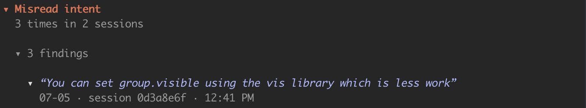
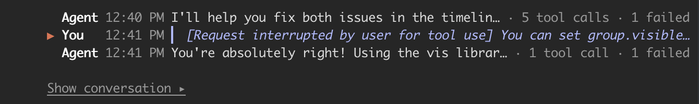
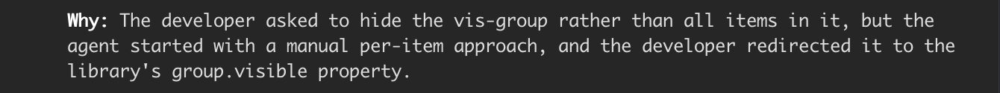
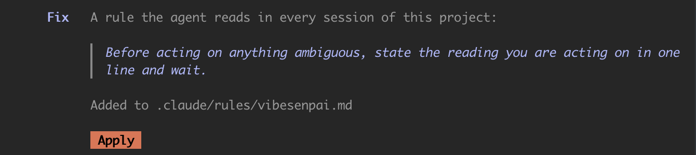

This page walks through one real finding as the pane shows it, part by part, and what each of
your answers to it does. A finding says where to look and why; whether it is right is yours to
decide.

The example is from the public test data of [claude-code-log](https://github.com/daaain/claude-code-log) (MIT).

## The row



- **The kind** comes first, with how often it happened: here, misread intent, 3 times in
  2 sessions.
- **Each finding** under it is headed by the words it is about, cut to fit. Here they are the
  developer's own: *"You can set group.visible using the vis library which is less work"*.
- **Under the words:** the date, the session and the time.

## The turns



Opening the finding shows the turns around the cited one, read from the transcript where Claude
Code keeps it. The cited turn is marked **▶**. Each agent turn says how many tool calls it made
and how many failed.

**Show conversation** opens those messages in full. **More around this** adds three messages on
each side.

## Why



**Why** is the model's one-line account of what went wrong.

## How to read it

The turns are the evidence; **Why** only summarises them. Here:

1. The developer asked to hide a timeline group, not every item in it.
2. The agent started hiding the items one by one.
3. The developer interrupted, pointing at the library's `group.visible`.
4. The agent agreed and switched.

The developer had to correct the course. A model finding can be wrong: if the turns do not bear
it out, press **Finding is wrong**.

## The fix



Each finding offers a change for your agent, with what kind of change it is, its exact text, and
where it lands. **Apply** drafts it into your prompt box; your Enter is the yes.
[Fixes and Apply](/vibesenpai/start/fixes/) has the details.

## Your answers


| answer | use it when |
|---|---|
| **Finding is wrong** | it did not happen as described |
| **Not the agent's fault** | it happened, but it was not the agent's mistake |
| **Hide** | you have seen it |

All three hide the finding and take it out of the pane's counts, Before and Since included. Your
answer is kept as a record of what you said. With no answer, the finding stands and its fix stays
on offer.

**Not the agent's fault** is offered only when the cited words are your own, as here. When they
are the agent's, only **Finding is wrong** and **Hide** are shown.

Each answer takes effect at once and offers **Undo**. Nothing is deleted: **Restore all** on the
Health tab brings hidden findings back.

## When nothing is flagged

If nothing has been found, the Findings tab says so, with how many sessions were read:

```
Nothing flagged in 40 sessions read.
```

That is a result. The checks ran over those sessions and found nothing they could tie to a
turn. Nothing is added to fill the pane.

## Across your history

**Open full report** at the bottom of the Findings tab, or
[`/vibesenpai:report`](/vibesenpai/commands/report/), writes every finding in your history to
one HTML file.
