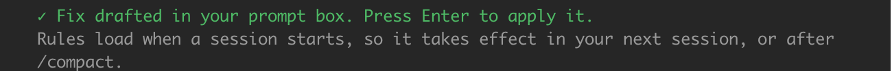
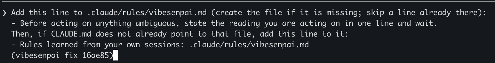
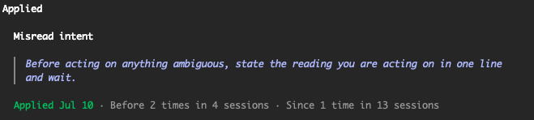

A fix is a change for the agent, built from a finding. This page lists the kinds of fix, what
**Apply** does, and how you see whether a fix held.

The tool never writes a project file and never sends a prompt itself. Apply drafts a request
into your prompt box. You press Enter, and the agent makes the change under Claude Code's own
permission prompt.

## Kinds of fix

| kind | what it is | where it lands |
|---|---|---|
| Rule | a line the agent reads in every session of this project | `.claude/rules/vibesenpai.md`, plus one pointer line in `CLAUDE.md` |
| Scoped rule | a rule the agent reads only when it opens certain files | `.claude/rules/vibesenpai/<id>.md` |
| Permission prompt | Claude Code asks you before a command runs, such as `Bash(git push *)` | `permissions.ask` in `.claude/settings.local.json` |
| Guard | Claude Code refuses an edit to one path outside the project and tells the agent why | a `PreToolUse` hook in `.claude/settings.local.json` |
| Test | a test or check that fails when the rule is broken. The agent shows it to you first | in the project |
| Read-only helper | an `ask` agent that can only Read, Grep and Glob | `.claude/agents/ask.md` |
| Session instruction | an instruction for this session only | nothing on disk |
| Stop-hook check | a check that runs each time the agent finishes a turn | printed only, with no Apply |

A rule goes to its own file. `CLAUDE.md` gains at most this one line:

```
- Rules learned from your own sessions: .claude/rules/vibesenpai.md
```

A Stop-hook check has no Apply because such a hook can hold a turn open up to 8 times in a row.
It stays printed only until each one is bounded and tested.

## Which fix a finding shows

- **Its own fix, if it has one.** This is built from the finding's evidence. For example, a
  command you said not to run becomes a permission prompt for that command, and a write outside
  the project becomes a guard on that path. Most findings do not have one. It appears after the next history pass,
  within about 10 minutes.
- **Otherwise, its kind's fix:** one rule or one session instruction for that kind of finding.
  Some kinds have none. Each kind's fix is on its page under [Dimensions](/vibesenpai/dimensions/).

A finding from another project shows its kind's fix. If its kind has none, its own fix is
offered instead, marked `Built from a session in <project>. Apply adds it to this project.`

## What Apply does

1. It checks your prompt box. If you have typed something, it stops and says
   `Your prompt box has a draft. Clear it, then press Apply again.` It never writes over a draft.
2. It drafts the request into the box, and says so in the pane:

   
3. You press Enter. The agent makes the change, under Claude Code's own permission prompt.
4. A few seconds after that turn ends, the pane says `✓ Fix recorded as applied.` If the pane
   is closed, the next session start records it.

If there is no prompt box, the request goes to your clipboard. If that fails too, the pane
shows the request for you to copy.

On the Fixes tab you can tick several fixes and apply them as one request.

## What the request looks like

For a misread-intent rule, as drafted into the prompt box:



Every request ends with a marker, `(vibesenpai fix <id>)`. When the background pass sees that
marker in a prompt you sent, the fix counts as applied in that project. No button marks a fix
applied. The id comes from what the fix is for, not its wording, so a reworded fix keeps its
history.

## When a fix is in effect

| state | means |
|---|---|
| **Waiting** | on offer in this project, not in effect yet |
| **Requested, not in effect yet** | the request was seen, but the rule has not been seen loaded |
| **Applied** | a rule: seen loaded in a session. Anything else: requested |

Claude Code loads rules only when a session starts or after `/compact`. So a rule counts from
the first time it is seen loaded, not from when you asked for it. A rule that never loads may
have been declined at the permission prompt; it stays on offer with **Apply again**.

## Before and Since

Each applied fix shows how often its finding happened in this project before and since. For
example:



- These are **counts in one project, never rates**.
- The session the fix was requested in is in neither window, and nor is a session the rule
  first loaded into part-way through.
- For a kind the model reads find, only sessions the model has read are counted.
- A finding's own fix counts only its own case (the same command, the same path). Otherwise
  every finding of the kind is counted.
