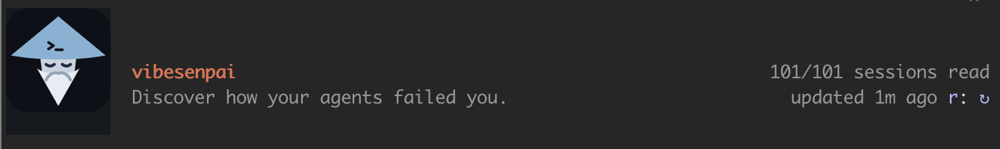
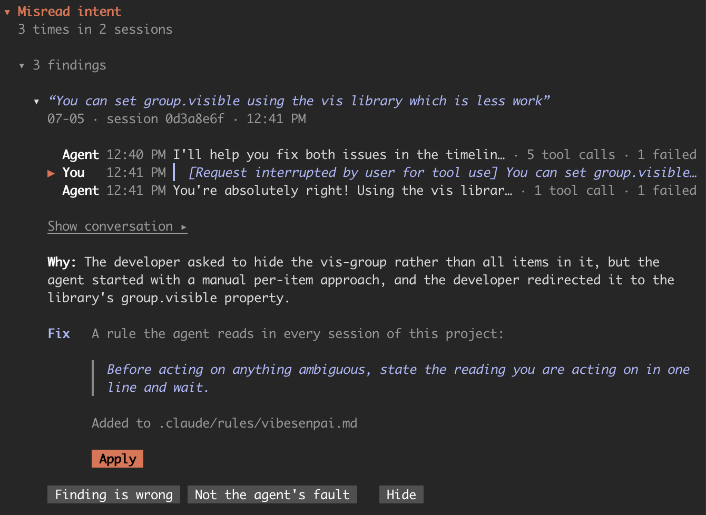
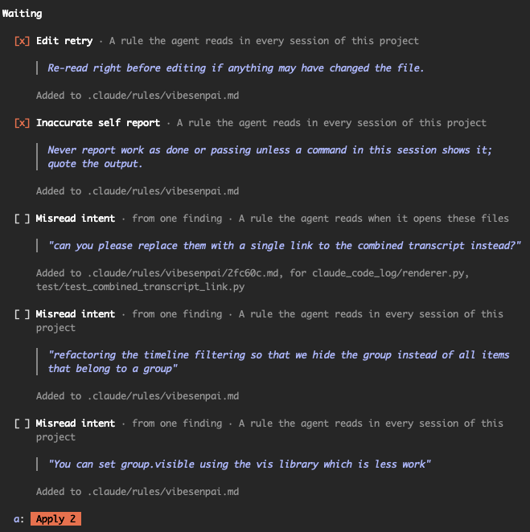
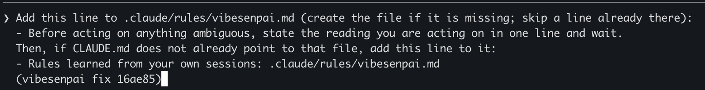
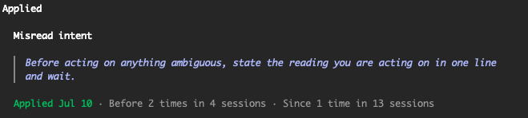
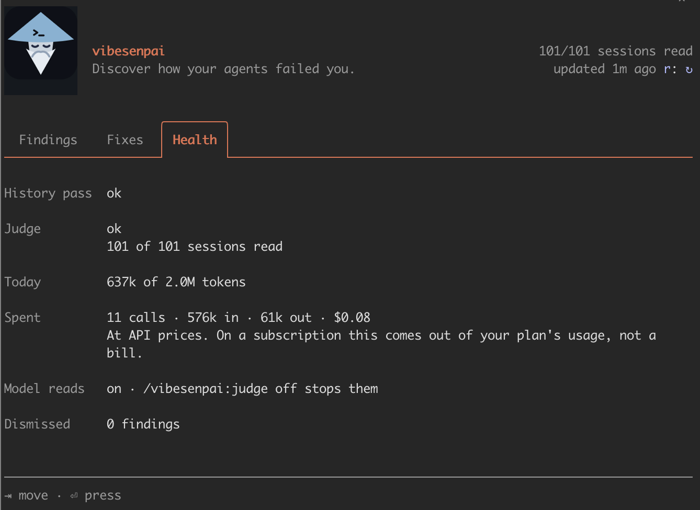

`/vibesenpai:insights` opens a pane beside the chat. This page walks through what each part of
it shows and what each button does.

Opening the pane spends nothing: it shows what the background passes have already worked
out. Where Claude Code cannot draw a pane, the command prints a
[text version](/vibesenpai/commands/insights/) instead.

The first time it opens, it says `Reading your history` with a seconds counter, and
`The free checks come first. Model reads begin when this turn ends.`

## The header

- **How much has been read**, as `12/40 sessions read`, or a progress bar while the model reads
  are catching up.
- **When it last updated**, as `updated 3m ago`, with **↻** (or `r`) to refresh. An open pane
  also checks for new results every 30 seconds and after each turn.
- **A failing job**, if there is one, in one line: `The history pass is retrying: <reason>` or
  `The judge is held: <reason>`.
- **Three tabs:** Findings, Fixes, Health. `⇥` moves between buttons; `⏎` presses one.

## Findings tab

From top to bottom:

1. **Model reads progress.** Until the model reads have found anything, a card shows how far
   they have got (`N of M`) and what happens next, for example `Begins when this turn ends.`
   or `Today's limit is reached; it continues tomorrow.` After the first model finding, it
   becomes the progress bar in the header.
2. **New since you last looked.** Up to three findings that arrived since you last opened the
   pane.
3. **What went wrong, by kind.** One block per kind of finding, most frequent first, each with
   `N times in M sessions`. Inside, `▸ N findings` lists them three at a time. The kind's fix,
   if it has one, is below the list.
4. **Cache rebuilt.** When the prompt cache was thrown away and written again from scratch:
   `N times · N tokens written again`. Opened, it lists the three largest.
   ([Cache rebuilds](/vibesenpai/dimensions/cache-rebuilds/))
5. **Open full report** writes and opens the [HTML report](/vibesenpai/commands/report/).
   **Hide all** hides every finding; they still count.

When nothing has been flagged, the tab says `Nothing flagged in N sessions read.` That is a
result, not an unfinished pass.

### A row

A row's headline is **your own words**, in italics: your reaction if the finding quotes you,
otherwise the request the agent was answering. Only when neither exists does it show the
agent's words or the file involved, and those are never styled as yours.

Under the headline: other kinds the finding also is (`also overreach`), the day, the session,
and the time of the first cited turn.

### An open finding

Press a row to open it. The pane reads the conversation around the cited turns from the
transcript and shows each message on one line: **You** or **Agent**, the time, the words, and
how many tool calls there were. Cited messages are marked `▶`.

- **Show conversation ▸** shows those messages in full.
- **More around this** adds three messages on each side.
- If Claude Code no longer keeps the transcript, the pane says so and shows the words it
  stored when the finding was made.

Below the conversation, where the finding has them:

| field | what |
|---|---|
| **Established** | where the expectation was set before the agent acted: an earlier prompt, or a loaded instruction |
| **Why** | the model's one-sentence account of what went wrong |
| **Reasons** | for a free check, why Claude Code refused each time, as `2× not read first` |
| **Cost** | for a free check, as `1.2k+ tokens written and discarded` |

Then the **fix**: what kind of change it is, the change itself, where it lands, and **Apply**.
[Fixes and Apply](/vibesenpai/start/fixes/) explains what Apply does.

Last, three answers: **Finding is wrong**, **Not the agent's fault** and **Hide**. Each takes
effect at once and offers **Undo**. [Your first finding](/vibesenpai/start/first-finding/#your-answers)
says what each one records.

## Fixes tab

**Waiting** lists every fix on offer in this project that is not in effect yet. Each shows who
it is for (`For overreach, from 3 findings in 2 sessions.`), the change, and where it lands.
Tick several and press **Apply 2** (or `a`) to draft them as one request.

**Applied** lists each fix in effect in this project, newest first, with how often its kind of
finding happened before and since:

These are counts, not rates. [Fixes and Apply](/vibesenpai/start/fixes/#before-and-since) says
which sessions each count covers.

## Health tab

| row | what |
|---|---|
| **History pass** | the free checks' background job: `ok`, `running`, `retrying · <reason>` or `not run yet` |
| **Judge** | the model reads' job, in the same words or `held · <reason>`, and `N of M sessions read` |
| **Today** | tokens used today against the daily limit, as `N of 2.0M tokens` |
| **Spent** | all model reads so far: calls, tokens in and out, and dollars |
| **Older** | past sessions older than the catch-up, which are not read |
| **Model reads** | `on` or `off`, with the command that changes it |
| **Dismissed** | how many findings are hidden, with **Restore all** |

The dollar figure is Claude Code's own, at API prices. On a subscription it is plan usage, not
a bill.
