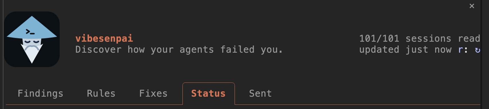
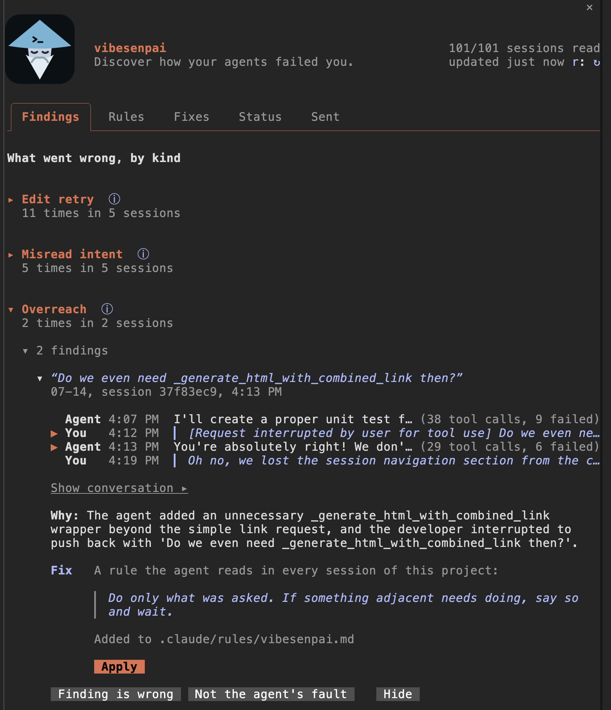
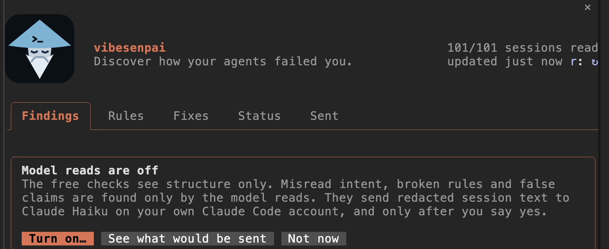
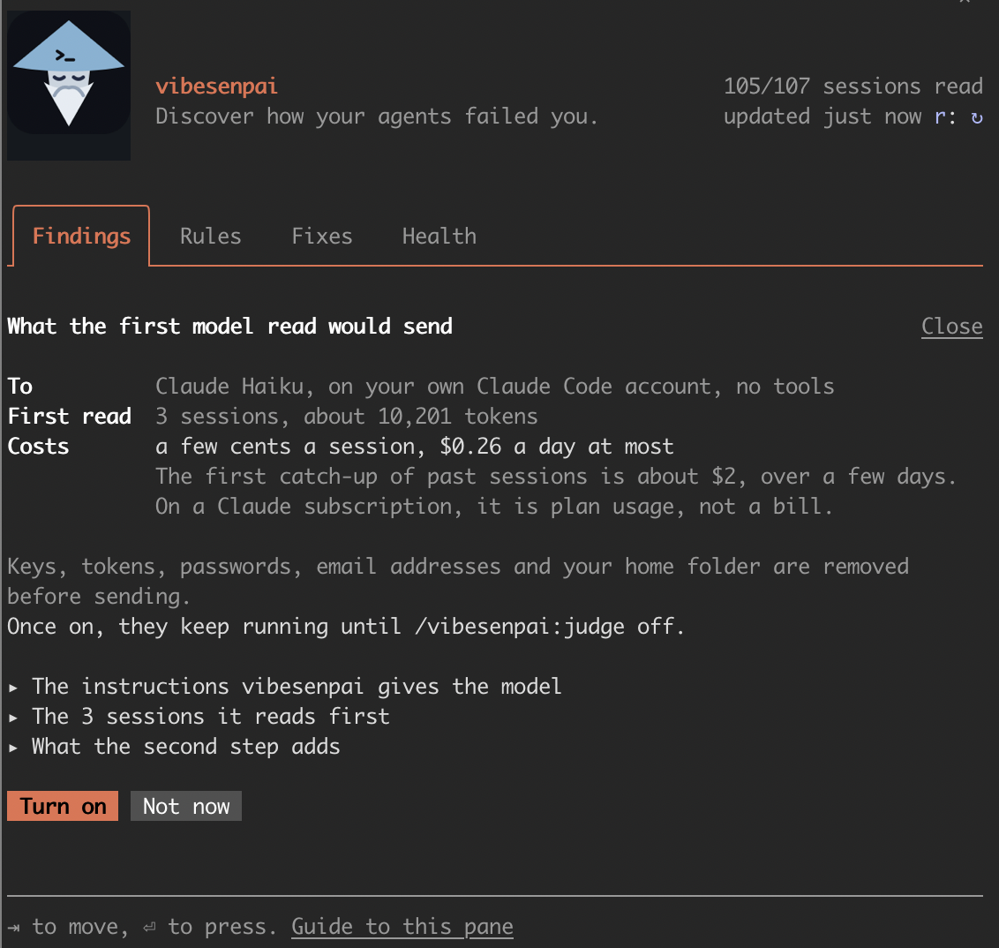
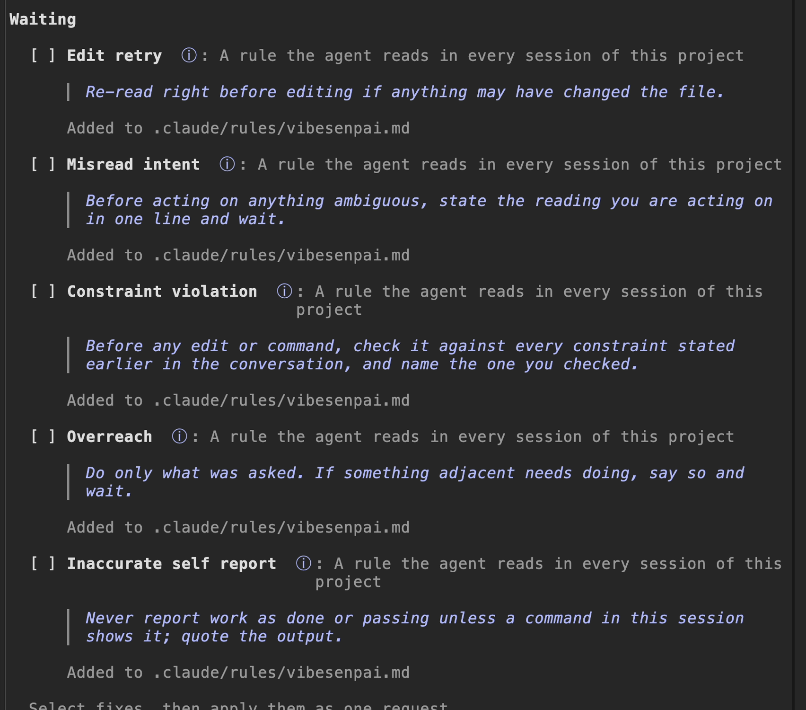
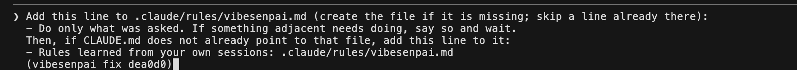
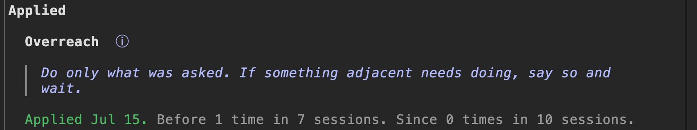
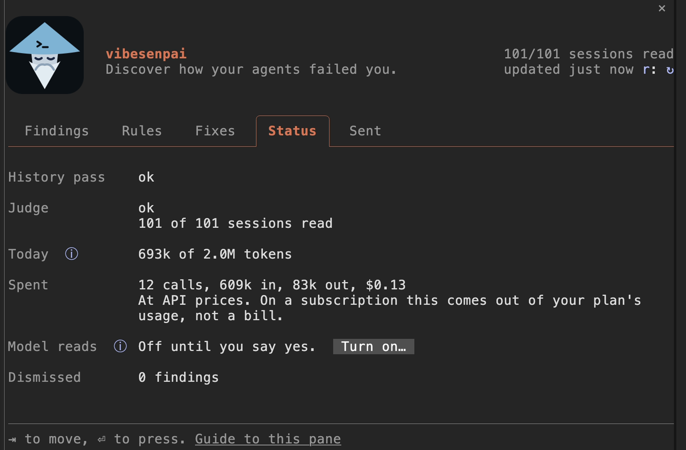
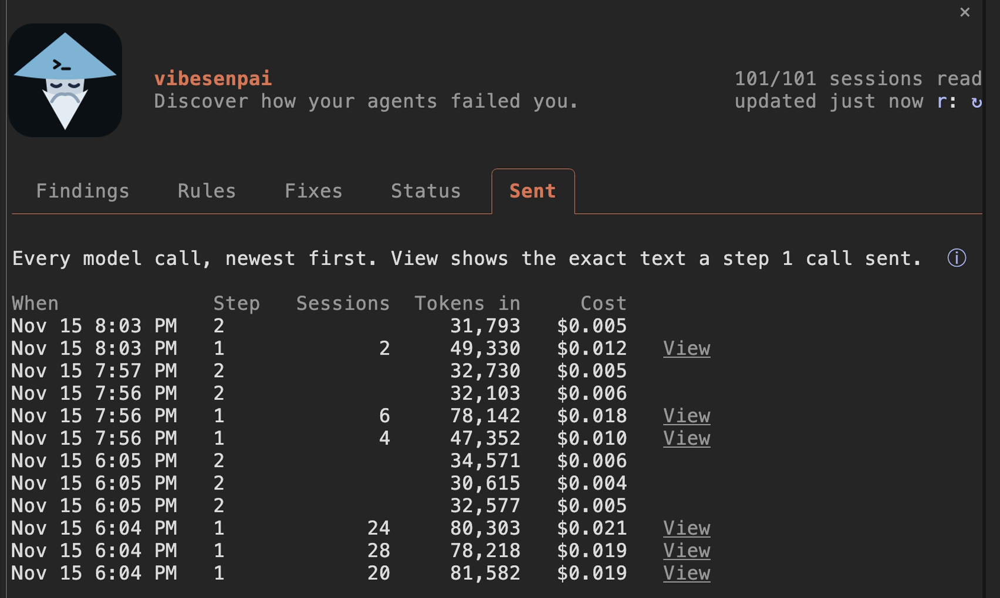

`/vibesenpai:insights` opens a pane beside the chat. This page walks through what each part of
it shows and what each button does.

Opening the pane spends nothing. It shows what two background jobs have already worked out:

- **The history pass** runs the free checks over your sessions, at most every 10 minutes.
- **The judge** is what does the model reads, after a turn ends.

If Claude Code cannot place a pane, the command prints a
[text version](/vibesenpai/commands/insights/) instead.

The first time it opens, it says `Reading your history` with a seconds counter, and
`The free checks come first.`

## The header

- **How much has been read**, as `12/40 sessions read`, or a progress bar while the model reads
  are catching up.
- **When it last updated**, as `updated 3m ago`, with **↻** (or `r`) to refresh. An open pane
  also checks for new results every 30 seconds and after each turn.
- **A failing job**, if there is one, in one line: `The history pass is retrying: <reason>` or
  `The judge is held: <reason>`. *Held* means the model reads stopped after 3 failed paid calls
  in a row; they stay stopped until you run `/vibesenpai:judge on`, then `/vibesenpai:judge yes`.
- **Five tabs:** Findings, Rules, Fixes, Status, Sent. `⇥` moves between buttons; `⏎` presses one.

## Findings tab

From top to bottom:

1. **Model reads are off**, until you say yes. A card says what only the model reads can find,
   with **Turn on…**, **See what would be sent** and **Not now**. **Turn on…** opens the exact text
   the first read would send, built by the same code a real read uses and sent nowhere, with
   **Turn on** ready, so Enter is the yes. **See what would be sent** opens the same, to read first:
   - **To**, **First read**, **Then** and **Costs**: where it goes, how much, and what it costs;
   - what is removed before sending, and that a yes lasts until `/vibesenpai:judge off`;
   - the instructions given to the model, the sessions it reads first (one row; it opens to five,
     then all) and what the second step adds, each opening to its exact text.

   **Turn on** is the yes. **Not now** folds the card into the Status tab. A tab, **Close**, or
   opening the pane again goes back to the tabs.
   [How your data is used](/vibesenpai/start/sends-and-costs/) describes it.

   

   
2. **Model reads progress.** Once they are on, until they have found anything, a card shows how far
   they have got (`N of M`) and what happens next, for example `Begins when this turn ends.`
   or `Today's limit is reached; it continues tomorrow.` After the first model finding, it
   becomes the progress bar in the header.
3. **New since you last looked.** Up to three findings that arrived since you last opened the
   pane.
4. **What went wrong, by kind.** One block per kind of finding, most frequent first, each with
   `N times in M sessions`. Inside, `▸ N findings` lists them three at a time. The kind's fix,
   if it has one, is below the list.
5. **Cache rebuilds.** When the prompt cache was thrown away and written again from scratch:
   `N times, N tokens written again`. Opened, it lists the three largest.
   ([Cache rebuilds](/vibesenpai/dimensions/cache-rebuilds/))
6. **Open full report** writes and opens the [HTML report](/vibesenpai/commands/report/).
   **Hide all** hides every finding and takes them out of the counts.

When nothing has been flagged, the tab says `Nothing flagged in N sessions read.` That is a
result, not an unfinished pass.

### A row

A row's headline is **your own words**, in italics: your reaction if the finding quotes you,
otherwise the request the agent was answering. Only when neither exists does it show the
agent's words or the file involved, and those are never styled as yours.

Under the headline: any secondary kinds, shown as `also overreach`, then the day, the session,
and the time of the first cited turn.

### An open finding

Press a row to open it. The pane reads the conversation around the cited turns from the
transcript and shows each message on one line: **You** or **Agent**, the time, the words, and
how many tool calls there were. Cited messages are marked `▶`.

- **Show conversation ▸** shows those messages in full.
- **More around this** adds three messages on each side.
- If Claude Code no longer keeps the transcript, the pane says so and shows the words it
  stored when the finding was made.

Below the conversation, where the finding has them:

| field | what |
|---|---|
| **Why** | the model's one-sentence account of what went wrong |
| **Reasons** | for a free check, why Claude Code refused each time, as `2× not read first` |
| **Cost** | for a free check, as `1.2k+ tokens written and discarded` |

Then the **fix**: what kind of change it is, the change itself, where it lands, and **Apply**.
[Fixes and Apply](/vibesenpai/start/fixes/) explains what Apply does.

Last, three answers: **Finding is wrong**, **Not the agent's fault** and **Hide**. Each takes
effect at once and offers **Undo**. [Your first finding](/vibesenpai/start/first-finding/#your-answers)
says when to use each.

## Rules tab

What Claude was given in this project, and what it never sees: the instruction files your sessions
loaded, memory that does not load by itself, and a few facts about the files. [Rules](/vibesenpai/start/rules/)
describes it.

## Fixes tab

**Waiting** lists every fix on offer in this project that is not in effect yet. Each shows what
it is for (`For overreach, from 3 findings in 2 sessions.`), the change, and where it lands.
Tick several and press **Apply N** (or `a`), where N is how many you ticked, to draft them as
one request.

**Applied** lists each fix in effect in this project, newest first, with how often its kind of
finding happened before and since:

These are counts, not rates. [Fixes and Apply](/vibesenpai/start/fixes/#before-and-since) says
which sessions each count covers.

## Status tab

| row | what |
|---|---|
| **History pass** | the job that runs the free checks: `ok`, `running`, `retrying (<reason>)` or `not run yet` |
| **Judge** | the job that does the model reads, in the same words or `held (<reason>)`, and `N of M sessions read` |
| **Today** | tokens used today against the daily limit, as `N of 2.0M tokens` |
| **Spent** | all model reads so far: calls, tokens in and out, and dollars |
| **Older** | past sessions the model reads skip. The first time, they read your 200 most recent past sessions (the catch-up); older ones are not read automatically |
| **Model reads** | `On, until /vibesenpai:judge off.`, or `Off until you say yes.` with **Turn on…** |
| **Dismissed** | how many findings are hidden, with **Restore all** |

The dollar figure is Claude Code's own, at API prices. On a subscription it is plan usage, not
a bill.

## Sent tab

Every model call, newest first, 20 to a page; **Older** and **Newer** move between pages.

| column | what |
|---|---|
| **When** | the day and time of the call |
| **Step** | `1` reads the sessions; `2` names the dimension of what step 1 found |
| **Sessions** | how many sessions a step 1 call read |
| **Tokens in** | the tokens sent, as Claude Code counted them |
| **Cost** | Claude Code's own figure, at API prices |

**View**, on a step 1 call, cuts the same part of your transcript again and checks it against the
fingerprint taken when it was sent: a match says it is exactly what was sent. A step 2 call has
no View, because it is built from the model's own reply and only its size is kept.
[How your data is used](/vibesenpai/start/sends-and-costs/#what-was-sent-without-keeping-a-copy)
explains why no copy is kept.
