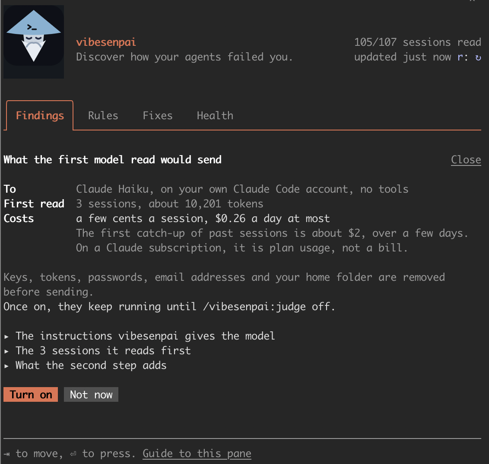
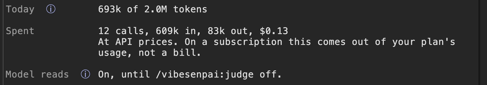

vibesenpai has two parts. The **[free checks](/vibesenpai/dimensions/#free-checks)** run on your machine and send nothing. The **[model
reads](/vibesenpai/dimensions/#model-reads)** send redacted session text to a model, and they are off until you say yes after seeing
exactly what they would send. This page describes both, with real examples.

## In short

| | |
|---|---|
| **read** | your session files in `~/.claude/projects/`, in place. Never changed, never copied |
| **kept** | the store (`~/.local/share/vibesenpai` by default): findings, your answers, settings, already redacted. Never your session text |
| **sent** | nothing, until you turn the model reads on. Then redacted session text, to Claude Haiku, on your own Claude Code account |
| **when** | after a turn ends, in the background, never while you wait |
| **cost** | usually a few cents a session at most, within 2M tokens a day |

No third party is involved, and there is no service of ours. What is sent is text your model
provider has already seen in the session.

## What stays on your machine

The free checks read your session files where Claude Code keeps them and work out what they
find from the structure of the session: which edits failed, which calls repeated, when the
cache was rebuilt. They never read the text of your prompts to decide, and they send nothing.

The store keeps what was found, your answers and settings. What it keeps is redacted when it is
written. It never holds a copy of your sessions: a finding points back at the turns in your own
file.

## Model reads: off until you say yes

The model reads find what structure cannot: a request misread, a rule broken, work claimed but
not done. To do that, a model has to read the conversation.

They start **off**. `/vibesenpai:insights` shows a card saying so, and **See what would be sent**
builds the exact text of the first read, with the same code and the same redaction a real read
uses, and sends it nowhere. You read it, then press **Turn on** or **Not now**.
`/vibesenpai:judge on` shows the same preview in the chat, and `/vibesenpai:judge yes` is the yes.



Turning them on keeps them running on Claude Haiku, in your own Claude Code account, after each
turn ends, until you turn them off with `/vibesenpai:judge off`. Turning them off forgets the yes:
turning them on again shows a new preview. Nothing a file says can turn them on; only you can.

## Where it goes

To the `claude` command you are already signed in to, run as `claude -p` with **no tools
allowed**, so the model can only read and answer. It runs on your plan, or your API key if
Claude Code uses one, or Bedrock or Vertex if Claude Code is set up for them. It runs in its own
folder, where vibesenpai's hooks do nothing, and the transcript that call leaves behind is never
read.

The model is Claude Haiku by default ([the `model` setting](/vibesenpai/reference/#model-read-settings)).

## What a read sends, step by step

Each read is two calls, and a finding is kept only after two checks on your machine.

![How a model read goes from your transcript to a finding: on your machine the step 1 packet is built, redacted, and sent only if redaction would change nothing more. Claude Haiku finds where the collaboration broke down, with quotes. If it found anything, a step 2 packet of its notes, earlier prompts and instruction lines goes back for it to name each dimension. Back on your machine, a finding whose quote is not in what was sent is discarded, and a misread intent, constraint violation or other finding that cannot cite where the expectation was set is kept aside. The rest are findings, shown in the pane.](../../../diagrams/read-flow.svg)

**Step 1** sends a packet of the session and asks the model to find the places where the
collaboration broke down. A packet holds:

| part | what | cap |
|---|---|---|
| fixed instructions | the same text for everyone, telling the model what to look for | none |
| what you asked for | each of your prompts, in order, as a list | 600 characters each |
| your prompts | in the turns, whole | never cut |
| your slash commands | the command, and the instructions it loaded | 2,000 characters, once |
| the agent's turns | its text, the tools it called and what they returned (files it read, command output) | 5,000 characters a turn in a short session, down to 500 in a long one |
| carried over | for a session read before: which turns are done, failures still open, earlier findings | 8 open failures |

A cut keeps the start and the end of a turn, and says how much was left out. A session too big
for one packet is read in parts.

**Step 2** runs only if step 1 found something. It sends the model's own notes from step 1, not
the session again, plus, to check whether the agent had been told:

| part | cap |
|---|---|
| your earlier prompts in that session | the 10 most recent and the most relevant, 300 characters each |
| lines of the CLAUDE.md, rules and memory files the session loaded | up to 8 lines, 300 characters each |

### Example: a step 1 packet

From a public session in [claude-code-log](https://github.com/daaain/claude-code-log)'s test data
(MIT), as it would be sent, shortened: the fixed instructions, an editor notice and two
repeated searches are left out. The other person's home folder in the paths is already rewritten
to `/Users/[USER]`:

```
=== SESSION 5ed31c36 ===

What the developer asked for, in order:
  turn 1: I keep getting mysterious build errors when MDX files have URLs wrapped in angle
  brackets that markdownlint puts in automatically (MD034/no-bare-urls) – how can I disable that?

Turns:
turn 1 | USER
I keep getting mysterious build errors when MDX files have URLs wrapped in angle brackets that
markdownlint puts in automatically (MD034/no-bare-urls) – how can I disable that?

────────────────────────────────────────

turn 2 | AGENT
I'll help you disable the MD034 rule that's causing issues with your MDX files. Let me first
check your current markdownlint configuration.

[Glob] **/.markdownlint*

[result ok] No files found

You don't currently have a markdownlint configuration file. I'll create one to disable the
MD034 rule that's wrapping your URLs in angle brackets.

[Write] /Users/[USER]/workspace/danieldemmel.me-next/.markdownlintrc.json

[result ok] File created successfully at: /Users/[USER]/workspace/danieldemmel.me-next/.markdownlintrc.json
```

### Example: a step 2 packet

Step 2's records come from step 1's reply, so this one is illustrative, on the same session:

```
=== LOOKBACK for the records of session 5ed31c36 ===
Earlier, the developer said:
  turn 1: "I keep getting mysterious build errors when MDX files have URLs wrapped in angle
  brackets that markdownlint puts in automatically (MD034/no-bare-urls) – how can I disable that?"

--- RECORD 1 ---
name: Config File Not Picked Up
alignment goal: intention
description: The developer asked how to stop markdownlint from wrapping URLs. The agent created
.markdownlintrc.json. The developer reported the errors continued.
evidence: "how can I disable that?"
  (the request)
```

## Every safety layer, in order

1. **Redacted when read.** Every prompt, command, path and tool output is redacted as the
   session file is parsed, before anything else sees it, and again until nothing changes.
2. **Cut at safe points.** A cut never splits a redaction marker, and is moved back if it would
   leave half a secret behind.
3. **Redacted again as a packet.** The finished session text is redacted once more.
4. **Checked before every call.** Right before each of the two calls, the packet is redacted
   again and compared. If anything would still change, the call is not made and nothing is
   sent. The text that failed is never logged.
5. **One read at a time.** A read holds a lease, checked before every call and every write, so
   two reads never send the same text twice.
6. **An isolated call.** No tools, and its own folder, where vibesenpai's hooks do nothing.
7. **Limits.** At most 2M tokens a day, and the first catch-up reaches back 200 sessions at most.

What is removed: private keys; tokens with a known provider prefix (Anthropic, OpenAI, GitHub,
Slack, AWS, Google, GitLab, npm, Stripe, Hugging Face and others); JWTs and bearer tokens;
credentials inside URLs; values of secret-named variables (`*_TOKEN`, `*_SECRET`, `PASSWORD`,
`API_KEY` and the like); email addresses; your username in home-folder paths.

What is **not** removed: ordinary code and command output the agent's tools returned; file
paths below your home folder; commands, commit hashes and ids, which are the evidence; and
names. Nothing is removed just because it looks random, so a secret with no known prefix and no
secret-like name can pass through.

## What it costs

Usually a few cents a session at most, at API prices. A day is capped at 2M tokens, about
$0.26 at most, and the first catch-up of up to 200 past sessions comes to about $2, spread over
several days by that cap. On a Claude subscription it counts toward your plan's usage instead of
a bill.

These are Claude Code's own cost figures, recorded with every call, measured on 2026-11-15 over
the author's own sessions: $1.13 for 385 calls and about 12.9M tokens, most of each call's fixed
overhead served from the prompt cache. Your sessions will differ; the Status tab shows your own.



## See it for yourself

| | |
|---|---|
| the card in `/vibesenpai:insights` | the exact text the next read would send, before you say yes |
| `/vibesenpai:judge on` | the same preview, summarised in the chat |
| the pane's **Sent** tab | every call made: when, which step, how many sessions, tokens and cost. **View** shows a step 1 call's text |

### What was sent, without keeping a copy

vibesenpai does not keep what it sent: that would be a second copy of your sessions. For each
call it records when, which step, the size and tokens, which part of which session it was cut
from, and a fingerprint (a SHA-256 hash) of the exact text. **View** cuts the same part from your
transcript again, renders it the same way, and compares fingerprints: a match is shown as exactly
what was sent. If Claude Code has deleted that transcript, or redaction has changed since, it
says so instead. Step 2 is built from the model's own reply, so only its size and contents
(records, earlier prompts, instruction lines) are kept.

## How to stop it

| | |
|---|---|
| `/vibesenpai:judge off` | stops the model reads and forgets the yes. The free checks keep running |
| `/plugin disable vibesenpai` | stops everything, hooks included |
| `VIBESENPAI_DISABLE=1` | the same as disabling, from the environment Claude Code runs in |
