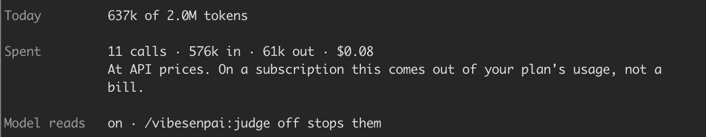

The model reads are on from installation. This page says what they send, where it goes, when,
and how many tokens they use.

## In short

| | |
|---|---|
| **read** | `~/.claude/projects/`, in place. Never changed, never copied |
| **written** | the store (`~/.local/share/vibesenpai` by default): findings, your answers, settings and reports, already redacted |
| **sent** | redacted session text, to the model, on your own Claude Code account (plan or API key) |
| **when** | in the background, after a turn ends |
| **how much** | at most about 2M tokens a day |

Your transcripts stay on disk. What is sent is text your provider has already seen in the
session. No third party is involved, and there is no service of ours.

## Whose account it runs on

Yours. The model reads call the `claude` CLI you are already signed in to. They run on your
plan, or on your API key if Claude Code uses one. If Claude Code is set up for Bedrock or
Vertex, the text goes there.

The model is Claude Haiku by default ([the `model` setting](/vibesenpai/reference/#model-read-settings)).

## What is sent

For each session, a packet of its text:

- **Your prompts, whole.** Your words are never cut.
- **The agent's turns, capped.** The cap depends on how long the session is: 5,000 characters
  a turn in a short session (up to 8 turns), down to 500 in a long one (more than 74).
- **What the agent's tools returned**, inside those turns: files it read, command output,
  search results. So code and output from a session can be part of what is sent.

It never opens your repository. It sees only what the agent's tools returned in the session, so
it cannot judge code the agent never looked at.

A cut keeps the start and the end of a turn, and says how much was left out.

The call allows no tools: the model reads and answers; it cannot act.

## Redaction, checked before every call

Secrets are removed when the packet is built. Right before each call, the packet is checked
again. If redaction would still change anything, the call is not made.

What is removed:

- private keys
- tokens with a known provider prefix: Anthropic, OpenAI, GitHub, Slack, AWS, Google, GitLab,
  npm, Stripe, Hugging Face and others
- JWTs and bearer tokens
- credentials inside URLs
- values of secret-named variables (`*_TOKEN`, `*_SECRET`, `PASSWORD`, `API_KEY` and the like)
- email addresses
- your username in home-directory paths

Commands, paths, commit hashes and ids are kept, because they are the evidence. Nothing is
removed just because it looks random.

[Where redaction happens in the pipeline](/vibesenpai/architecture/judge/)

## When it runs

Only when a turn ends. The `Stop` hook starts the model reads in the background and exits, so
your session never waits on them. Opening `/vibesenpai:insights` or `/vibesenpai:report` sends nothing.

Nothing is spent before the first turn after installation ends. Then the pass reads:

- **your past sessions, once:** up to 200, newest first. It never goes further back on its own.
- **each live session again** after about 50 new turns.
- **within about 2M tokens a day** (your local day). When the limit is reached, it stops and
  continues the next day. The last call before the limit can take it slightly over.

[Phases of a run](/vibesenpai/architecture/phases/)

## What it costs

The model reads stop for the day at about 2M tokens. What one session costs depends on its
length. A call carries up to 60,000 tokens of session text plus about 26k of fixed overhead, so
short sessions share a call. A batch of sessions makes up to two calls.

Each call's tokens and Claude Code's dollar figure for it are recorded.
`/vibesenpai:judge` and the pane's Health tab show them:

The dollar figure is at API prices; on a subscription it is plan usage, not a bill.

## How to stop it

| | |
|---|---|
| `/vibesenpai:judge off` | stops the model reads. The free checks keep running; nothing is sent. `/vibesenpai:judge on` turns them back on |
| `/plugin disable vibesenpai` | stops everything, hooks included |
| `VIBESENPAI_DISABLE=1` | the same as disabling, from the environment Claude Code runs in |
