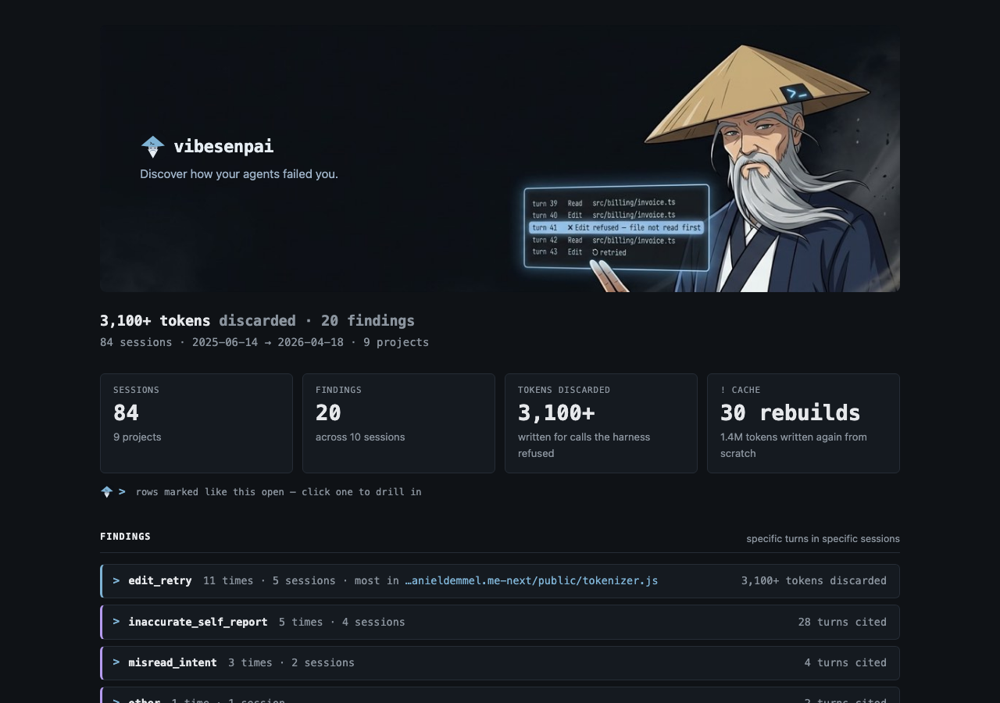

vibesenpai reads the session transcripts Claude Code already keeps on your disk and shows
you where the agent went wrong. Each finding is shown in a pane beside the chat:

- **Your words.** A finding's headline is what you said: the request the agent answered, or
  your reaction when it went wrong.
- **The turns.** When it happened, and the conversation around it, read from the transcript
  in place.
- **The fix.** A change addressed to the agent: a rule, a permission prompt, a guard. Apply
  drafts it into your prompt box, and nothing changes until you press Enter.

## Two outputs

Everything it produces is one of two things:

| | |
|---|---|
| **Evidence** | specific turns in specific sessions, with the words that were said |
| **Something applicable** | a rule, a setting or a guard for the agent, which you can Apply |

A finding is shown only with the turns it points at, and every fix comes from a finding.

## What it is not

- **Not a score.** There is no grade, rating or percentage of how well you or the agent did.
- **Not advice to you.** It does not tell you how to prompt. Every fix is addressed to the
  agent, as something Claude Code loads or enforces.
- **Not a dashboard of numbers.** A count appears beside the turns it counts. Cache figures
  appear only when the cache was rebuilt from scratch.
- **Not a second copy of your sessions.** Transcripts are read where Claude Code keeps them.
  What it stores is its own findings and settings.

## The free checks and the model reads

**The free checks** read the structure of a session (which edits Claude Code refused and
had to be retried, when the cache was rebuilt) and cost nothing. **The model reads** send a
redacted part of each session to Claude Haiku on your own Claude Code account to find what
structure cannot show, such as a constraint broken or a claim that was not true; they are on
by default and [have limits and an off switch](/vibesenpai/commands/judge/).

The kinds it looks for are listed under [Dimensions](/vibesenpai/dimensions/). What leaves
your machine is on [What it sends, and what it costs](/vibesenpai/start/sends-and-costs/).

## Where you use it

In Claude Code, through three slash commands:

| | |
|---|---|
| [`/vibesenpai:insights`](/vibesenpai/commands/insights/) | opens the pane |
| [`/vibesenpai:judge`](/vibesenpai/commands/judge/) | turns the model reads on or off |
| [`/vibesenpai:report`](/vibesenpai/commands/report/) | writes the HTML report of your history |

Two hooks keep the analysis current in the background. At the start of a session, a short
summary of your recent history may appear; it reaches you, not the agent.

## Supported

**Claude Code only.** The parser layer is built to take other harnesses, and one parser
exists today.
