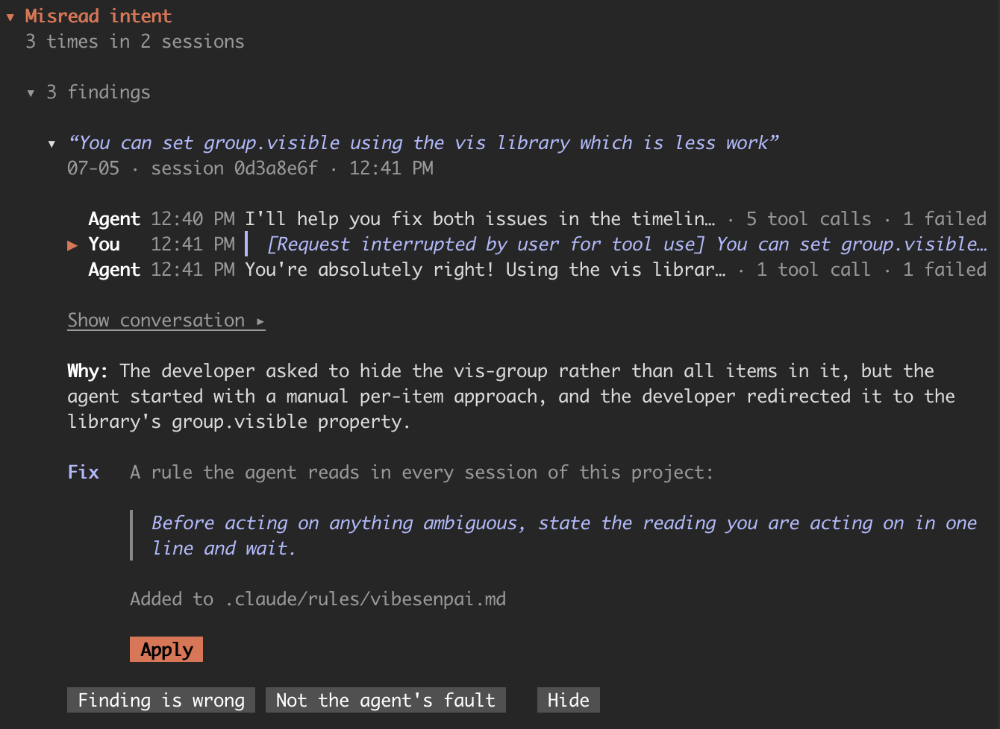
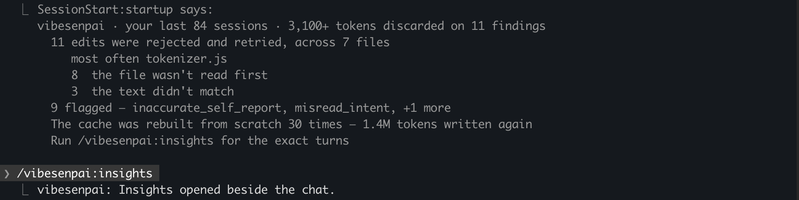

vibesenpai reads the session transcripts Claude Code already keeps on your disk and shows you
where the agent went wrong. This page says what a finding contains and what the tool does not do.

## What a finding contains

Each finding is shown in a pane beside the chat, with three parts:

- **Your words.** The headline is what you said: the request the agent answered, or your
  reaction when it went wrong.
- **The turns.** When it happened, and the conversation around it, read from the transcript
  where it is.
- **The fix.** A change for the agent: a rule, a permission prompt, a guard or a test.
  **Apply** drafts it into your prompt box. Nothing changes until you press Enter.

Everything it produces is one of two things:

- **Evidence:** specific turns in specific sessions, with the words that were said.
- **Something applicable:** a rule, a permission prompt, a guard or a test, for the agent.

Every finding points at turns, and every fix comes from a finding.

## What it does not do

- **No score.** There is no grade, rating or percentage for you or the agent.
- **No advice to you.** It does not tell you how to prompt. Every fix is for the agent: something
  Claude Code loads or enforces.
- **No dashboard of numbers.** A count is shown next to the turns it counts.
- **No copy of your sessions.** Transcripts are read where Claude Code keeps them. Only findings,
  your answers, settings and reports are stored.

## How it finds things

There are two kinds of check:

| | what it reads | cost |
|---|---|---|
| **The free checks** | the structure of a session: edits Claude Code refused and the agent retried, times the prompt cache was rebuilt | nothing |
| **The model reads** | a redacted part of each session, sent to Claude Haiku on your own Claude Code account (plan or API key), to find what structure cannot show: a broken constraint, a claim that was not true | tokens, within a daily limit |

The model reads are on by default. [`/vibesenpai:judge`](/vibesenpai/commands/judge/) has their
limits and the off switch. [What leaves your machine](/vibesenpai/start/sends-and-costs/)
says exactly what is sent. Every kind of finding is listed under
[Dimensions](/vibesenpai/dimensions/).

## How you use it

Three slash commands in Claude Code:

| | |
|---|---|
| [`/vibesenpai:insights`](/vibesenpai/commands/insights/) | opens the pane |
| [`/vibesenpai:judge`](/vibesenpai/commands/judge/) | turns the model reads on or off |
| [`/vibesenpai:report`](/vibesenpai/commands/report/) | writes an HTML report of your history |

Two Claude Code hooks, one at session start and one when a turn ends, keep the analysis current
in the background.

## At session start

When a session starts, a short summary may appear. It counts your recent sessions
and their findings, how many findings are new since your last session, the cache rebuilds, and
whether the history pass or the model reads are failing. It is shown to you, not to the agent.

## What it supports

Claude Code only.
